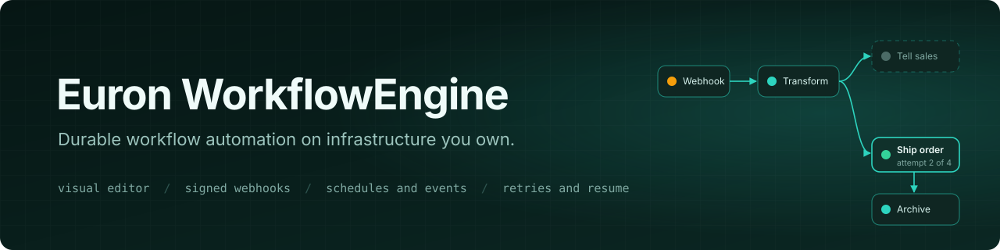
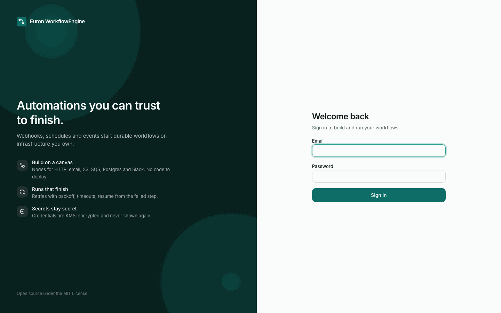

  

  
  
  
  
  
  
  
  

  
  
  
   
  
  
  
  
   
  

**Euron WorkflowEngine** is an open-source, MIT-licensed workflow automation platform, part of
the open-source initiative of **ENGAGESPHERE TECHNOLOGY PRIVATE LIMITED**. Build automations
on a visual canvas, trigger them from signed webhooks, schedules and events, and run them on a
durable engine with retries, timeouts, cancellation and resume, on infrastructure you own.

  

> [!NOTE]
> Everything in the tour ran for real: Docker Compose on a laptop, with S3, SQS, SES and KMS
> emulated locally and provisioned by the same Terraform modules that build production.
> `make up && make demo` reproduces it.

<h3 align="center">Built by the team behind Euron</h3>

Euron WorkflowEngine comes from the people who build these platforms. If you like how this repository is built, come and see what we build with it.

  <a href="https://euron.one"><picture><source media="(prefers-color-scheme: dark)" srcset="docs/assets/brand/euron-dark.svg"></picture></a>
  <a href="https://euronsystems.com"><picture><source media="(prefers-color-scheme: dark)" srcset="docs/assets/brand/euron-systems-dark.svg"></picture></a>
  <a href="https://alphaeuron.com"><picture><source media="(prefers-color-scheme: dark)" srcset="docs/assets/brand/alpha-euron-dark.svg"></picture></a>

  
  
  
  
  

---

The full guide (quickstart, architecture, API, deployment, security and testing) lands with
the first release. Until then, start with the
[high-level design](docs/architecture/HLD.md).
