<p align="center">
  
</p>

<p align="center">
  
  <a href="LICENSE"></a>
  
  
  
  
  
  
</p>

<p align="center">
  <a href="https://github.com/euron-sde-team/euron-workflow-engine/stargazers"></a>
  <a href="https://github.com/euron-sde-team/euron-workflow-engine/fork"></a>
  <a href="https://github.com/euron-sde-team/euron-workflow-engine/watchers"></a>
  <br>
  <a href="https://github.com/euron-sde-team/euron-workflow-engine/issues"></a>
  <a href="https://github.com/euron-sde-team/euron-workflow-engine/pulls"></a>
  <a href="https://github.com/euron-sde-team/euron-workflow-engine/commits/main"></a>
  
  <br>
  <a href="#built-by-the-team-behind-euron"></a>
</p>

<p align="center">
  <b><a href="#-quickstart">Quickstart</a></b> ·
  <b><a href="#️-architecture">Architecture</a></b> ·
  <b><a href="#-explore-the-repository">Explore the repo</a></b> ·
  <b><a href="docs/api/openapi.json">API reference</a></b> ·
  <b><a href="#️-deploy-to-aws">Deploy</a></b> ·
  <b><a href="docs/architecture/security.md">Security</a></b> ·
  <b><a href="#-documentation">Docs</a></b>
</p>

**Euron WorkflowEngine** is an open-source, MIT-licensed workflow automation platform, part of
the open-source initiative of **ENGAGESPHERE TECHNOLOGY PRIVATE LIMITED**. Build automations
on a visual canvas, trigger them from signed webhooks, schedules and events, and run them on a
durable engine with retries, timeouts, cancellation and resume, on infrastructure you own.

<p align="center">
  
</p>

> [!NOTE]
> Everything in the tour ran for real: Docker Compose on a laptop, with S3, SQS, SES and KMS
> emulated locally and provisioned by the same Terraform modules that build production.
> `make up && make demo` reproduces it.

<h3 align="center">Built by the team behind Euron</h3>

<p align="center">Euron WorkflowEngine comes from the people who build these platforms. If you like how this repository is built, come and see what we build with it.</p>

<p align="center">
  <a href="https://euron.one"><picture><source media="(prefers-color-scheme: dark)" srcset="docs/assets/brand/euron-dark.svg"></picture></a>
  <a href="https://euronsystems.com"><picture><source media="(prefers-color-scheme: dark)" srcset="docs/assets/brand/euron-systems-dark.svg"></picture></a>
  <a href="https://alphaeuron.com"><picture><source media="(prefers-color-scheme: dark)" srcset="docs/assets/brand/alpha-euron-dark.svg"></picture></a>
</p>

<p align="center">
  <a href="https://www.instagram.com/euron_official"></a>
  <a href="https://www.linkedin.com/company/euronone/posts/"></a>
  <a href="https://x.com/euron712"></a>
  <a href="https://www.youtube.com/@Euron-official"></a>
  <a href="https://whatsapp.com/channel/0029VaeeJwq9RZAfPW9P2l07"></a>
</p>

---

## 📚 Table of contents

- [Why Euron WorkflowEngine](#-why-euron-workflowengine)
- [At a glance](#-at-a-glance)
- [Screenshots](#️-screenshots)
- [Features](#-features)
- [Architecture](#️-architecture)
  - [Life of a webhook](#life-of-a-webhook)
  - [How a step runs, fails and recovers](#how-a-step-runs-fails-and-recovers)
- [Tech stack](#-tech-stack)
- [Prerequisites](#-prerequisites)
- [Quickstart](#-quickstart)
- [Explore the repository](#-explore-the-repository)
- [API](#-api)
- [Configuration](#️-configuration)
- [Deploy to AWS](#️-deploy-to-aws)
- [Security model](#-security-model)
- [Testing](#-testing)
- [Documentation](#-documentation)
- [Roadmap](#️-roadmap)
- [FAQ](#-faq)
- [Contributing, security and license](#-contributing-security-and-license)

---

## 💡 Why Euron WorkflowEngine

Every company runs on small automations: ship the order when the payment lands, tell sales
about the big ones, charge the pending invoices at night, chase the customers who never
finished onboarding. Hosted automation tools make them easy to build and hard to trust: the
credentials live on someone else's servers, a failed run is a red row with no way back, and
the bill grows with every step. Cron jobs and scripts on a VM are the other extreme: cheap,
invisible, and silent when they break.

Euron WorkflowEngine is the middle path: a visual automation tool you run yourself, built on
an engine that treats every step as durable state.

- **Runs that finish.** Retries with exponential backoff and jitter, per-step and
  per-execution timeouts, cancellation, and **resume from the failed step** days later,
  without re-running what already succeeded.
- **Triggers you can expose.** Webhooks verified with HMAC-SHA256 (with replay protection)
  and deduplicated by idempotency keys; cron schedules in any time zone that fire exactly
  once even with several schedulers; an internal event bus that chains workflows.
- **Secrets that stay secret.** Credentials are envelope-encrypted with a per-credential KMS
  data key, never returned by the API, and redacted from everything a step stores.
- **No new infrastructure to babysit.** Postgres is the queue (`FOR UPDATE SKIP LOCKED`), so
  there is no broker to run; the same Terraform modules build AWS and the local emulator.

## 📊 At a glance

| | |
| --- | --- |
| **Apps** | Web app (canvas editor), API with webhook ingress, workers with a leader-elected scheduler, operator CLI |
| **Triggers** | Manual, signed webhooks, cron with time zones, intervals, internal events |
| **Nodes** | 21: HTTP request, transform (JMESPath and templates), set variables, if, switch, merge, loop, wait, stop, publish event, email (SES), Slack, S3 get and put, SQS publish, Postgres query |
| **Engine** | Postgres queue with `SKIP LOCKED`, guarded writes, heartbeats and a reaper, dead-path elimination for branches and merges, per-workflow concurrency limits |
| **Templates** | 7 working automations: order fulfillment, low-stock report, lead routing, invoice batches, uptime monitor, failure alerts, customer onboarding |
| **Infrastructure** | 13 Terraform modules, 3 environments (local emulator, AWS dev, AWS prod) |
| **Tests** | 246 unit (208 API, 38 web), 55 integration, 13 browser end-to-end, plus a QA crawl of every page at two widths |
| **License** | MIT |

## 🖼️ Screenshots

<table>
  <tr>
    <td width="50%">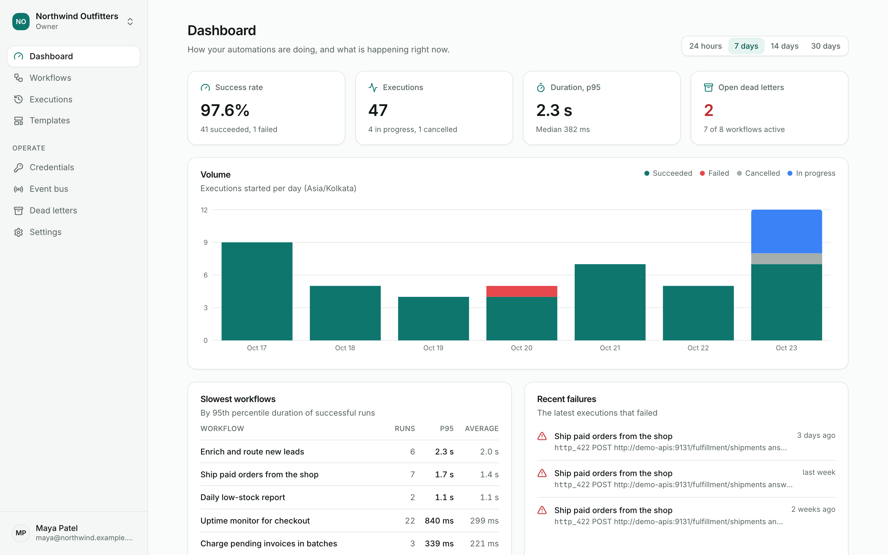<br><sub><b>Dashboard.</b> Success rate, volume per day in the workspace's time zone, the slowest workflows and recent failures.</sub></td>
    <td width="50%">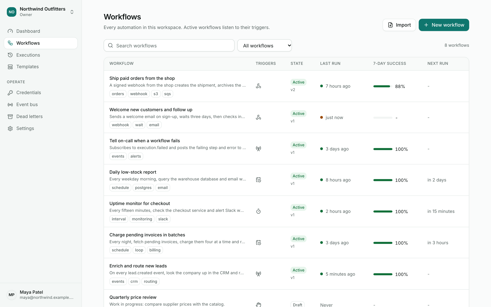<br><sub><b>Workflows.</b> Triggers, published version, last run, seven-day success and the next scheduled run.</sub></td>
  </tr>
  <tr>
    <td>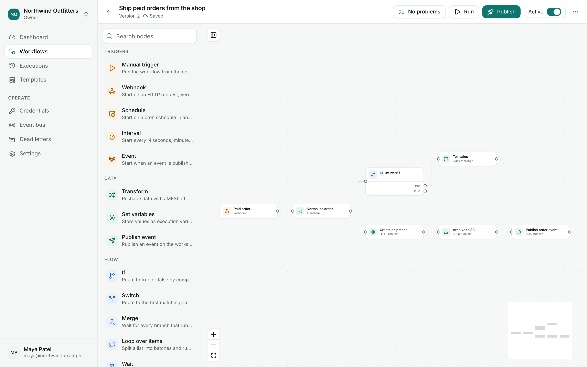<br><sub><b>Editor.</b> Drag nodes from the palette, connect ports, autosaved drafts, inline validation.</sub></td>
    <td>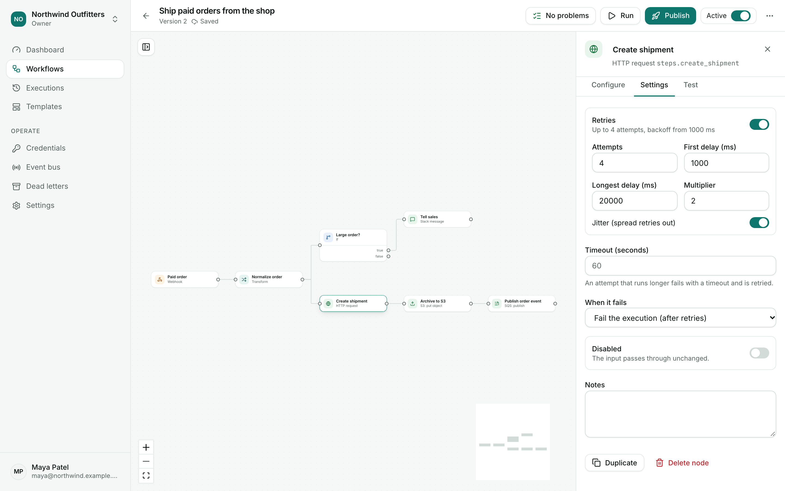<br><sub><b>Node settings.</b> Schema-generated forms, retries with backoff, timeouts, what to do on failure.</sub></td>
  </tr>
  <tr>
    <td>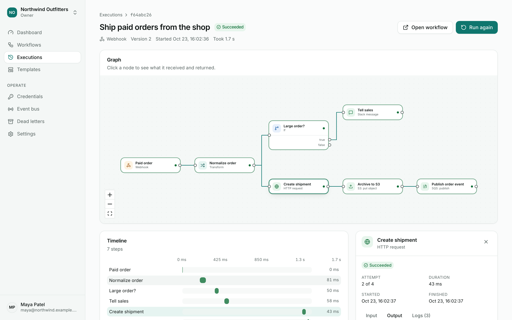<br><sub><b>Execution.</b> The graph as it ran, a timeline of every step and attempt, input and output per step.</sub></td>
    <td>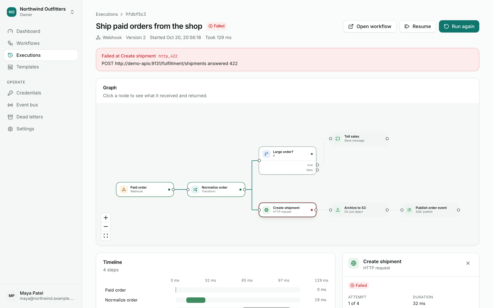<br><sub><b>Failures.</b> The failing step, its error and input; resume from it or run again.</sub></td>
  </tr>
  <tr>
    <td>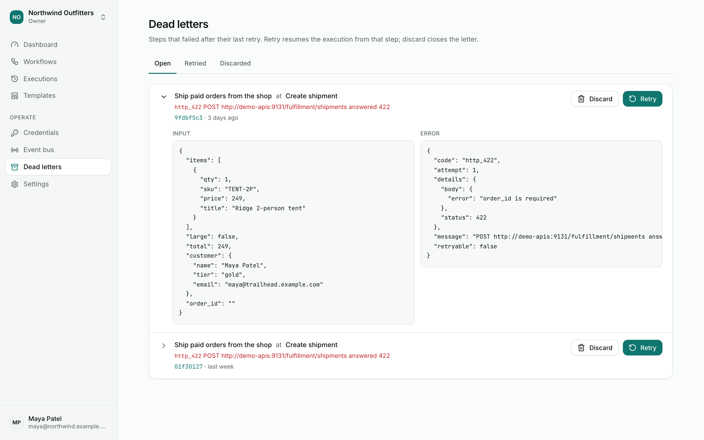<br><sub><b>Dead letters.</b> Steps that ran out of retries, with their input; retry resumes the execution.</sub></td>
    <td>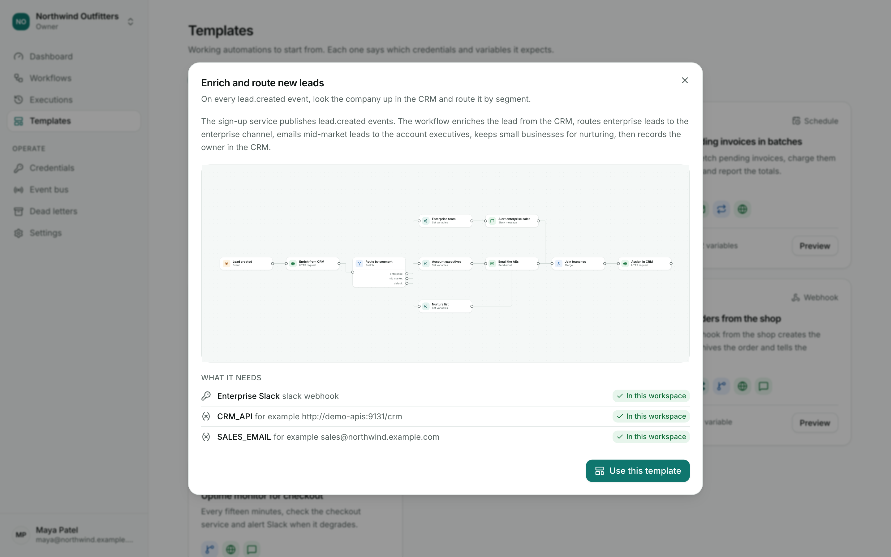<br><sub><b>Templates.</b> Seven working automations, with the credentials and variables each one needs.</sub></td>
  </tr>
  <tr>
    <td>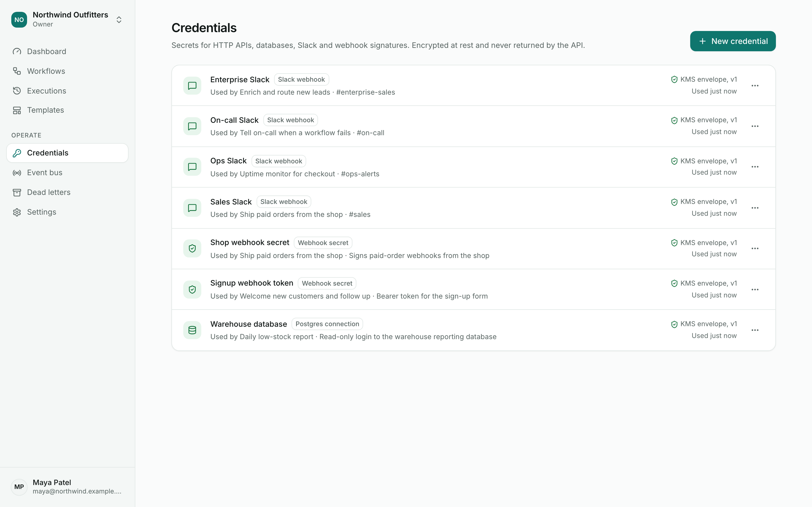<br><sub><b>Credentials.</b> Write-only secrets sealed with KMS; which workflows use each one.</sub></td>
    <td>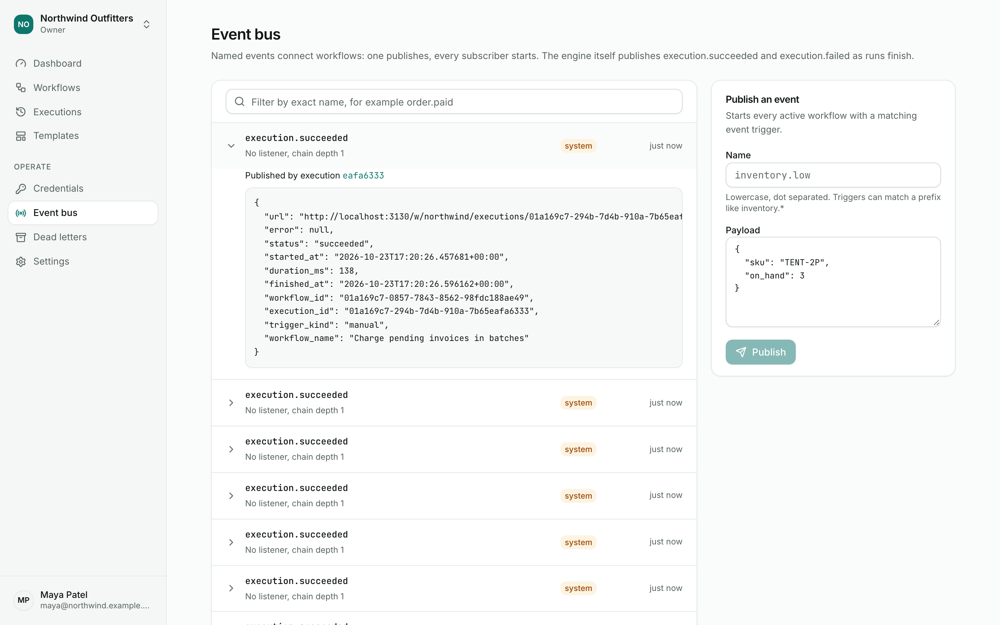<br><sub><b>Event bus.</b> Workflows publish and subscribe; failures become events other workflows handle.</sub></td>
  </tr>
  <tr>
    <td>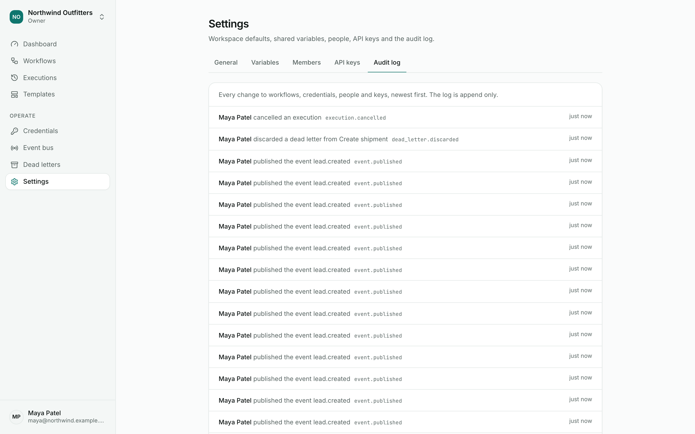<br><sub><b>Audit log.</b> Every change to workflows, credentials, people and keys, append-only.</sub></td>
    <td>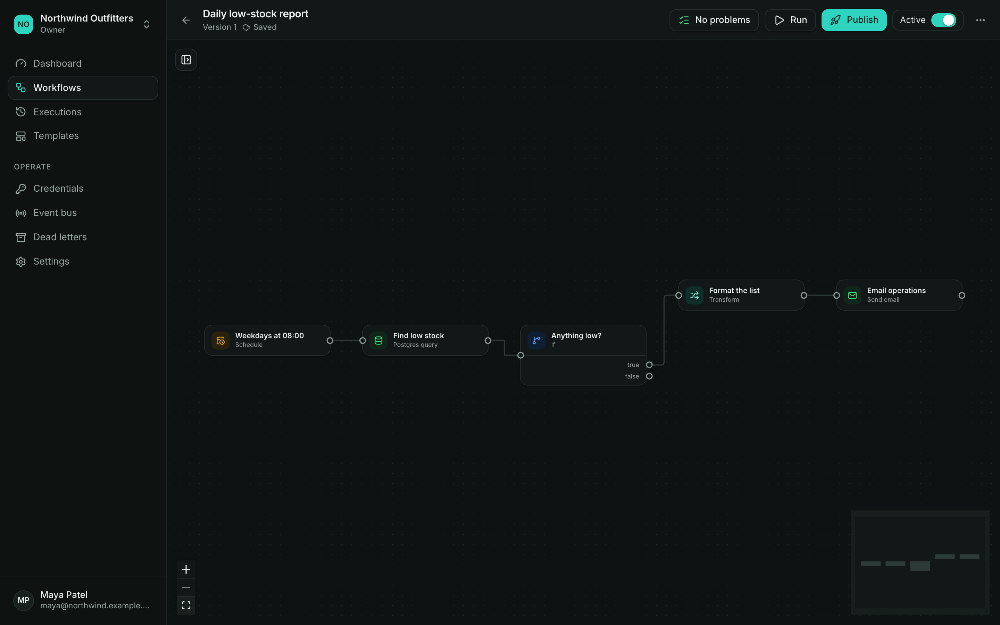<br><sub><b>Dark theme.</b> Follows the system setting, switchable from the account menu.</sub></td>
  </tr>
</table>

## ✨ Features

| Area | What you get |
| --- | --- |
| **Editor** | React Flow canvas with a searchable palette, drag and drop or click to add after the selected node, typed ports (true and false, switch cases, loop and done), connection rules, forms generated from each node's JSON schema, inline validation as you type, autosave with conflict detection, single-node test runs with the last run's data |
| **Triggers** | Manual runs with a payload; webhooks with HMAC-SHA256 or bearer auth, timestamped signatures against replay, idempotency keys and optional synchronous answers; five-field cron in any IANA time zone with defined daylight-saving behaviour; intervals; events with name patterns and payload filters |
| **Data and logic** | JMESPath with extra functions for strings, dates, numbers and collections; logic-free `{{ }}` templates; typed conditions; switch, merge (AND join), loop over items in batches, wait for a duration or until a time, stop with an error, execution variables, workspace variables (`{{ env.KEY }}`) |
| **Integrations** | HTTP with stored credentials, retries on chosen status codes and size limits; email through SES; Slack-compatible webhooks; S3 get and put; SQS publish; Postgres queries, read-only by default |
| **Engine** | Durable steps in Postgres, retries with exponential backoff and jitter, node and execution timeouts, cancellation (cooperative for running steps), resume from the failed step, retry from the start, dead letters, per-workflow concurrency limits, payload limits, idempotent starts |
| **Versions** | Draft and immutable published versions, restore, publish notes, JSON export with credentials by name, import that maps them back, duplicate |
| **Operations** | Executions list with filters and cursors, execution view (graph, timeline, step input and output, logs), dashboard, event bus, dead letters, Prometheus metrics, health and readiness probes, JSON logs with request ids |
| **Workspaces** | Owners, editors and viewers; members by email; workspace API keys with roles and expiry; time zone and retention settings; an append-only audit log |
| **Security** | KMS envelope encryption for credentials, value-based redaction, an outbound guard against SSRF (DNS-rebinding safe), S3 and SQS allowlists, CSRF and CORS checks, rate limits, a production boot guard |

## 🏗️ Architecture

<p align="center">
  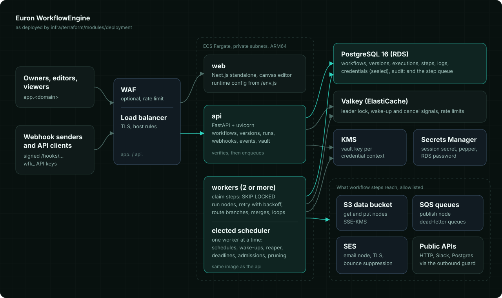
</p>

Three services run on ECS Fargate behind one Application Load Balancer, all from two images:

- **web** (`app.<domain>`): the Next.js app with the canvas editor. One image for every
  environment; it reads the API address at run time from `/env.js`.
- **api** (`api.<domain>`): the FastAPI service: auth, workspaces, workflows and versions,
  credentials, events, executions, and webhook ingress at `/hooks/{workspace}/{path}`.
- **workers**: claim ready steps from Postgres, run them, route to the next ones. Every worker
  stands for a Redis leader election; the leader also fires schedules and runs the sweeps.

[HLD](docs/architecture/HLD.md) | [LLD](docs/architecture/LLD.md) | [Data model](docs/architecture/data-model.md)

### Life of a webhook

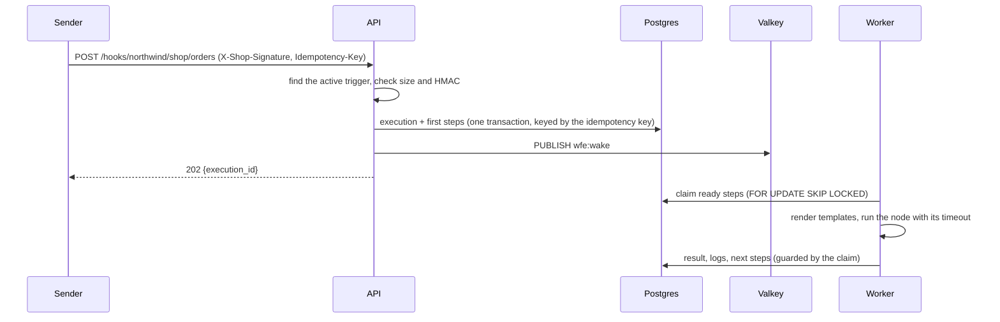

### How a step runs, fails and recovers

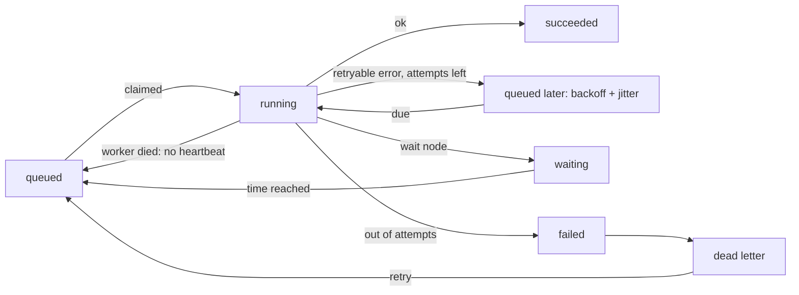

A failed step fails its execution (unless the node is set to continue), files a dead letter
with its input, and publishes `execution.failed`, which other workflows can handle. Resuming
re-queues only the failed step; everything that succeeded stays done. Read more:
[security](docs/architecture/security.md) | [threat model](docs/architecture/threat-model.md) |
[decision records](docs/architecture/adr/README.md)

## 🧰 Tech stack

| Layer | Choice | Why |
| --- | --- | --- |
| API and workers | Python 3.12, FastAPI, Pydantic v2, SQLAlchemy 2 (async), Alembic, typer | Typed end to end; one package runs the API, the workers and the CLI ([ADR 0001](docs/architecture/adr/0001-one-image-three-roles.md)) |
| Queue and state | PostgreSQL 16 | Steps are rows claimed with `SKIP LOCKED`: no broker, no dual writes ([ADR 0002](docs/architecture/adr/0002-postgres-as-the-queue.md)) |
| Coordination | Valkey (Redis-compatible) | Leader lock, wake-up and cancel signals, rate limits; never the source of truth ([ADR 0003](docs/architecture/adr/0003-leader-elected-scheduler.md)) |
| Expressions | JMESPath and logic-free templates | Reshaping data without running user code ([ADR 0004](docs/architecture/adr/0004-jmespath-and-safe-templates.md)) |
| Vault | AWS KMS envelope encryption, AES-256-GCM | Per-credential data keys bound to their workspace ([ADR 0006](docs/architecture/adr/0006-kms-envelope-encryption.md)) |
| Web | Next.js 16, React 19, React Flow, Tailwind 4, TanStack Query, Radix primitives, Recharts | A fast, accessible editor with one image for every environment |
| AWS | ECS Fargate (ARM64), ALB, WAF, RDS, ElastiCache, S3, SQS, SES, KMS, Secrets Manager, CloudWatch | Managed building blocks, least-privilege roles |
| Infrastructure as code | Terraform | The same modules build AWS and the local emulator ([ADR 0008](docs/architecture/adr/0008-floci-for-local-aws.md)) |
| Local AWS | Floci emulator, Mailpit | KMS, S3, SQS and SES on a laptop; every email readable in a browser |
| Tests | pytest, Vitest, Playwright, axe | Unit, integration against real services, browser end-to-end and an accessibility crawl |

## 📋 Prerequisites

| Tool | Version | Used for |
| --- | --- | --- |
| [Docker](https://docs.docker.com/get-docker/) with Compose v2 | 24+ | The local stack |
| [uv](https://docs.astral.sh/uv/) | 0.13+ | The API's Python environment, outside Docker |
| [Node.js](https://nodejs.org/) | 22 LTS | The web app and the browser tests, outside Docker |
| [pnpm](https://pnpm.io/) | 9 (`corepack enable`) | The JavaScript workspace |
| [Terraform](https://developer.hashicorp.com/terraform/install) | 1.10+ | Only for deploying to AWS (local runs use a pinned container) |
| [AWS CLI](https://aws.amazon.com/cli/) | 2 | Only for deploying to AWS |

Free local ports (each overridable in `deploy/compose/.env`): 3130 (web), 8130 (API), 5453
(Postgres), 6413 (Valkey), 4613 (AWS emulator), 9130 (Mailpit), 9131 (demo APIs).

## 🚀 Quickstart

```bash
git clone https://github.com/euron-sde-team/euron-workflow-engine.git
cd euron-workflow-engine

make up      # build and start everything; Terraform provisions the AWS emulator first
make demo    # three people, seven live workflows, two weeks of real executions
```

| Open | For |
| --- | --- |
| http://localhost:3130 | The app: `maya@northwind.example.com` (owner), `ravi@northwind.example.com` (editor) or `lena@northwind.example.com` (viewer) |
| http://localhost:8130/docs | The interactive API reference |
| http://localhost:9130 | Mailpit: every email the workflows send |
| http://localhost:9131/slack | The Slack-style channels the workflows post to |

The password for every demo account is printed by `make demo` (it is generated by `make env`
and stored in `deploy/compose/.env`). `make down` stops everything and deletes the data.

[Full local guide](docs/guides/quickstart-local.md) |
[Guided walkthrough](docs/guides/walkthrough.md) |
[Troubleshooting](docs/guides/troubleshooting.md)

## 🧭 Explore the repository

```text
euron-workflow-engine/
|-- apps/
|   |-- api/                     FastAPI service, workers, scheduler and CLI (one package)
|   |   |-- src/workflow_engine/
|   |   |   |-- api/                 routes and request dependencies
|   |   |   |-- services/            business rules: workflows, engine, steps, sweeps, vault, webhooks
|   |   |   |-- repositories/        all database access, scoped to a workspace
|   |   |   |-- engine/              pure core: definitions, validation, routing, expressions, cron
|   |   |   |-- nodes/               every node type: config schema, ports, run()
|   |   |   |-- runtime/             executor, scheduler, leader election
|   |   |   |-- integrations/        AWS clients, KMS key providers, guarded HTTP, signals
|   |   |   |-- templates/           the templates gallery
|   |   |   |-- demo/                demo APIs and the demo seed
|   |   |   `-- core/ db/ models/ schemas/ migrations/
|   |   `-- tests/                   unit and integration suites
|   `-- web/                     Next.js app: editor, executions, dashboard, templates, settings
|-- infra/
|   |-- terraform/               modules + envs (local-floci, aws-dev, aws-prod)
|   `-- docker/                  api and web images
|-- deploy/compose/              the local stack (Floci or real AWS overlay)
|-- e2e/                         Playwright: journeys, the QA crawl, screenshots and the tour
|-- docs/                        architecture, ADRs, guides, OpenAPI
`-- scripts/                     test services, deploy, one-off tasks, local env, sanitization
```

**Where to start reading:**

| To understand | Read |
| --- | --- |
| How a webhook becomes an execution | `services/webhooks.py`, then `services/engine.py` (`start`) |
| How a step is claimed and run | `runtime/executor.py`, `services/steps.py`, `repositories/executions.py` (`claim`) |
| How branches, merges and loops route | `engine/routing.py`, then `tests/unit/test_routing.py` |
| How retries, dead letters and resume work | `services/engine.py` (`fail`), `services/executions.py` (`resume`), `tests/integration/test_engine_reliability.py` |
| How schedules fire once | `runtime/scheduler.py`, `services/sweeps.py` (`fire_schedules`), `engine/cron.py` |
| How credentials are sealed | `services/vault.py`, `integrations/keys.py` |
| How it deploys | `infra/terraform/modules/deployment/main.tf`, then `scripts/aws-deploy.sh` |

Paths are under `apps/api/src/workflow_engine/` unless they start with `tests/`, `infra/` or
`scripts/`. The [walkthrough](docs/guides/walkthrough.md) follows one order from the webhook
to the resumed failure.

## 🔌 API

The [OpenAPI reference](docs/api/openapi.json) is exported from the application itself
(`make openapi`), so it always matches the code, and the running API serves it interactively
at `/docs`. Run a workflow from your own code with a workspace API key:

```bash
curl -s -X POST localhost:8130/api/v1/workspaces/northwind/workflows/$WORKFLOW_ID/run \
  -H "authorization: Bearer $WFE_API_KEY" -H 'content-type: application/json' \
  -H 'idempotency-key: nightly-2026-10-23' \
  -d '{"payload": {"order_id": "SO-1042"}}'
# {"execution_id": "...", "status": "queued", "duplicate": false}

curl -s localhost:8130/api/v1/workspaces/northwind/executions/$EXECUTION_ID \
  -H "authorization: Bearer $WFE_API_KEY" | jq '.status, .output'
```

Publish an event with `POST /api/v1/workspaces/{ws}/events`; every workflow subscribed to
it starts. Errors always have the shape `{"error": {"code", "message", "request_id"}}` and
every response carries an `X-Request-Id` header.

## ⚙️ Configuration

The API and the workers read their configuration from the environment. With
`APP_ENV=production` they refuse to boot, listing every problem at once, unless:

- the session secret and the API key pepper are random, at least 32 characters and different
- cookies are secure and CORS names the web app's origins
- credentials are sealed with KMS (`VAULT_PROVIDER=kms`), with no emulator endpoint configured
- the outbound guard is on (internal hosts are allowed one by one, never whole networks)

The web app reads `API_URL` and `PRODUCT_NAME` at run time from `/env.js`, so one image serves
every environment. Every variable is documented in the
[configuration reference](docs/guides/configuration.md).

## ☁️ Deploy to AWS

```bash
cp infra/terraform/envs/aws-dev/terraform.tfvars.example infra/terraform/envs/aws-dev/terraform.tfvars
# set name_prefix, domain, route53_zone_id, mail_identity and mail_from

make aws-deploy ENV=aws-dev       # registries, images, infrastructure, rollout
make aws-cli ENV=aws-dev ARGS="user create --email you@example.com --name 'You' --password '...' --admin"
```

`aws-deploy` creates the image registries, builds and pushes both images for ARM64 tagged
with the git commit, applies the rest of the infrastructure and waits for the API, worker and
web services to stabilise. Migrations run when the API boots, under an advisory lock. The
database password never appears in a task definition: the tasks read it from the RDS-managed
secret for each new connection.

| | aws-dev | aws-prod |
| --- | --- | --- |
| Availability zones | 2, one NAT | 3, NAT per zone, VPC interface endpoints |
| Database | single-AZ, 3-day backups | Multi-AZ, 14-day backups, deletion protection |
| Valkey | one node | primary and replica with failover |
| Edge | load balancer | load balancer with AWS WAF managed rules and rate limiting |
| Scaling | API 1 to 2, workers 1 to 2, web 1 to 2 | API 2 to 6, workers 2 to 8, web 2 to 6 |
| Logs | 14 days | 365 days, KMS-encrypted |

[Deployment guide](docs/guides/deploy-aws.md) | [Operations](docs/guides/operations.md)

## 🔐 Security model

| Concern | How it is handled |
| --- | --- |
| Credentials | Sealed with a per-credential KMS data key bound to its workspace and id; a separate vault key the task roles may use only with that context; never returned by the API; redacted from step output, errors and logs |
| Outbound calls | HTTP, Slack and Postgres nodes refuse private, loopback, link-local and metadata addresses, checked on the resolved IP at connect time (DNS rebinding safe) and on every redirect; S3 buckets and SQS queues are allowlisted |
| Webhooks | HMAC-SHA256 over the raw body with constant-time comparison, optional timestamp binding against replay, body size limits, idempotency keys, per-trigger rate limits |
| No code execution | JMESPath and logic-free templates instead of a code node; the Postgres node runs read-only transactions unless configured otherwise |
| Workspaces | Every query is scoped to the caller's workspace; non-members get 404; owners, editors and viewers; API keys never act as owners |
| Sessions | Argon2id passwords, signed sessions in HttpOnly SameSite cookies with a revocation list, an origin check on every cookie-authenticated write |
| Integrity | Immutable published versions, executions pinned to their version, guarded step writes, an append-only audit log |
| Infrastructure | Private subnets, TLS everywhere, KMS for every store, least-privilege task roles, checkov with justified exceptions only |

Full detail in [security](docs/architecture/security.md) and the
[STRIDE threat model](docs/architecture/threat-model.md). Report vulnerabilities privately:
see [SECURITY.md](SECURITY.md).

## 🧪 Testing

| Suite | What it proves | Run |
| --- | --- | --- |
| Unit (246: 208 API, 38 web) | Cron and DST rules, expressions, templates, routing through a simulator, validation, backoff, every node with fakes, the outbound guard, config guards, crypto, frontend logic | `make test` |
| Integration (55) | The real API, worker and scheduler against Postgres, Valkey, Floci and Mailpit: retries, dead letters and resume, timeouts, cancellation, concurrency, 12 racing claimers, exactly-once schedules, signed webhooks, events, KMS sealing, SES, S3, SQS, the demo seed | `make test-integration` |
| Browser (13) | Sign-in, building and publishing on the canvas, templates, a signed webhook with a retry, cancel, dead letters, events, credentials, API keys and the audit log | `make e2e` |
| QA crawl | Every page at desktop and mobile widths: no console errors, failed requests, broken links or serious accessibility violations | `make qa` |
| Infrastructure | `terraform validate` (3 environments), tflint, checkov | `make tf-validate tf-lint tf-security` |

[Testing guide](docs/guides/testing.md)

## 📖 Documentation

| Architecture | Guides |
| --- | --- |
| [High-level design](docs/architecture/HLD.md) | [Quickstart (local)](docs/guides/quickstart-local.md) |
| [Low-level design](docs/architecture/LLD.md) | [Guided walkthrough](docs/guides/walkthrough.md) |
| [Data model](docs/architecture/data-model.md) | [Configuration reference](docs/guides/configuration.md) |
| [Security](docs/architecture/security.md) | [Deploy to AWS](docs/guides/deploy-aws.md) |
| [Threat model](docs/architecture/threat-model.md) | [Local stack with real AWS](docs/guides/local-with-aws.md) |
| [Decision records](docs/architecture/adr/README.md) | [Operations](docs/guides/operations.md) |
| [API reference (OpenAPI)](docs/api/openapi.json) | [Testing](docs/guides/testing.md) and [Troubleshooting](docs/guides/troubleshooting.md) |

## 🗺️ Roadmap

- Sub-workflows: call another workflow as a step and wait for its result
- Approval steps that pause an execution until a person decides
- More nodes: Google Sheets, generic SMTP, S3 listing, SNS
- Per-workspace quotas for executions and steps
- SSO (SAML and OIDC) for workspaces

Have an idea? [Open a feature request](https://github.com/euron-sde-team/euron-workflow-engine/issues/new/choose).

## ❓ FAQ

<details>
<summary><b>How is this different from n8n, Windmill or Temporal?</b></summary>

Like n8n it is a visual automation tool with a node catalog; unlike it, there is no code node,
credentials are sealed with KMS, and every run is a durable state machine you can resume from
the failed step. Like Temporal it is built for runs that must finish, but you build workflows
on a canvas, not in code, and there is no separate cluster: Postgres is the queue.
</details>

<details>
<summary><b>Do I need AWS?</b></summary>

Not to try it, develop it or test it: locally everything runs in Docker, with KMS, S3, SQS
and SES emulated by Floci and provisioned by the same Terraform modules as production. A
production deployment (`APP_ENV=production`) seals credentials with AWS KMS, and the
Terraform in this repository targets AWS.
</details>

<details>
<summary><b>What happens if a worker crashes in the middle of a step?</b></summary>

Its claim stops heartbeating. After `STEP_STALE_S` the scheduler requeues the step and another
worker runs it; if the crashed worker comes back, its late result is refused because it no
longer holds the claim. Make side effects idempotent where it matters, for example with the
idempotency headers most payment and shipping APIs accept.
</details>

<details>
<summary><b>Can a schedule fire twice?</b></summary>

No. Firing is a compare-and-set on the trigger's next fire time plus an idempotency key per
tick, so even two schedulers (during a leader handover) start one execution per tick.
</details>

<details>
<summary><b>Why no code node?</b></summary>

Running user code safely needs a sandbox that holds against editors with credentials and
network access. JMESPath, templates and the node catalog cover reshaping and branching
without that risk ([ADR 0004](docs/architecture/adr/0004-jmespath-and-safe-templates.md)).
</details>

## 🤝 Contributing, security and license

Contributions are welcome: read [CONTRIBUTING.md](CONTRIBUTING.md) and the
[code of conduct](CODE_OF_CONDUCT.md). Report security issues privately as described in
[SECURITY.md](SECURITY.md).

Released under the [MIT License](LICENSE). Copyright (c) 2026 ENGAGESPHERE TECHNOLOGY
PRIVATE LIMITED and the Euron WorkflowEngine contributors.

<p align="center">
  If Euron WorkflowEngine saves you time, <b><a href="https://github.com/euron-sde-team/euron-workflow-engine/stargazers">star the repository</a></b>.
</p>
