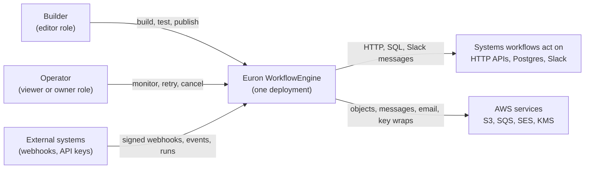
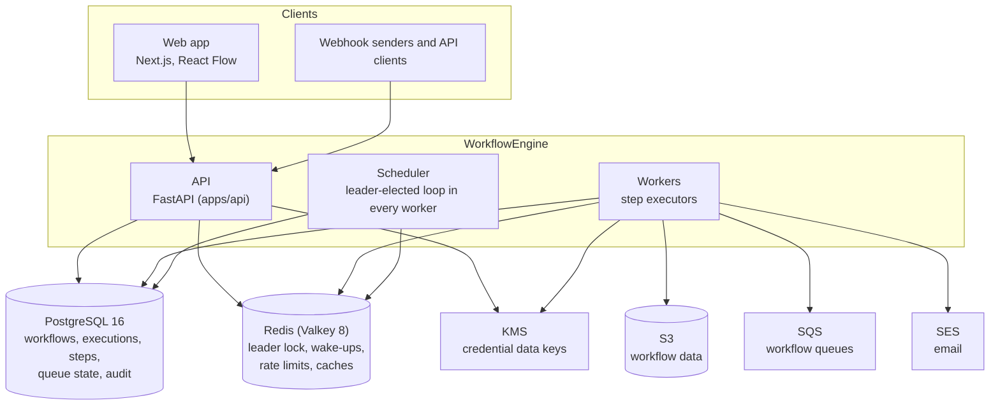
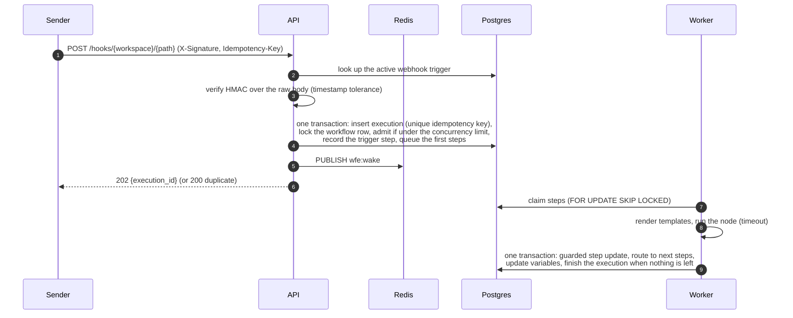
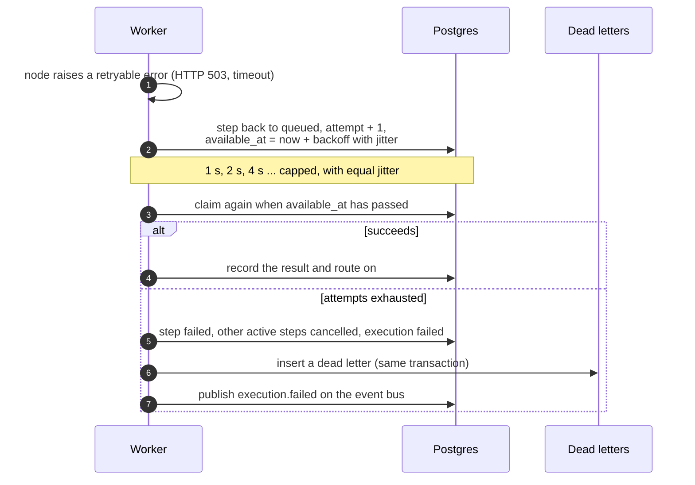
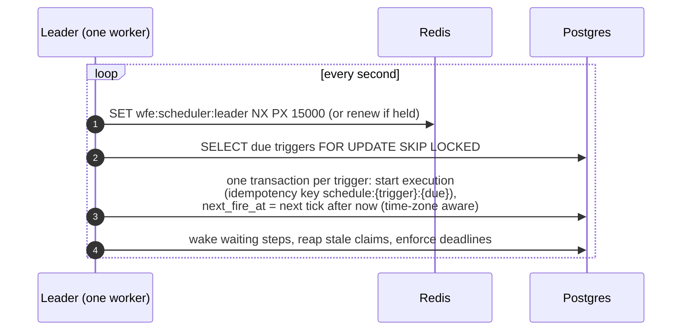
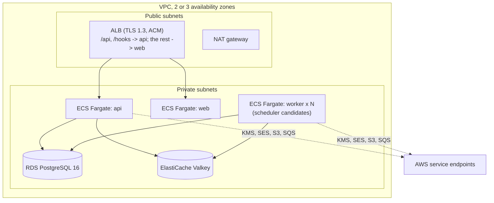
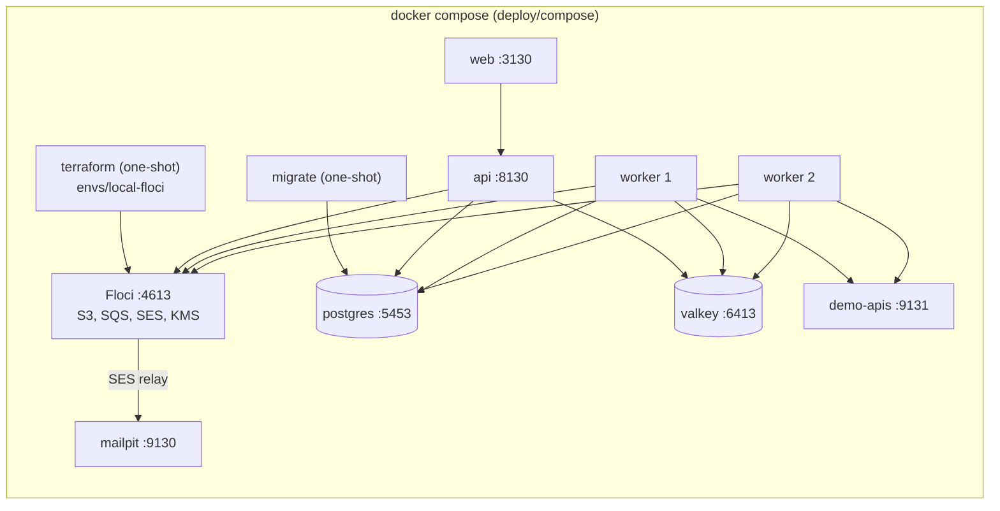

# High-Level Design

This document describes what Euron WorkflowEngine is made of, how the pieces talk to each
other, and how the system behaves under load and failure. The module-level detail is in the
[Low-Level Design](LLD.md), the tables in the [Data Model](data-model.md), and the reasoning
behind each major choice in the [ADRs](adr/README.md).

- [Product definition](#product-definition)
- [Goals and non-goals](#goals-and-non-goals)
- [System context](#system-context)
- [Containers](#containers)
- [Component responsibilities](#component-responsibilities)
- [Core concepts](#core-concepts)
- [Main flows](#main-flows)
- [API surface](#api-surface)
- [Deployment topology](#deployment-topology)
- [Scalability](#scalability)
- [Availability and failure modes](#availability-and-failure-modes)
- [Security summary](#security-summary)
- [Observability](#observability)
- [Key design decisions](#key-design-decisions)

## Product definition

Euron WorkflowEngine is self-hosted workflow automation for teams that want n8n-style
building blocks with Temporal-style guarantees, on infrastructure they own and without
writing code:

- **Build** a workflow on a canvas: drag nodes from a palette, connect them, and configure
  each one in a form generated from its schema. Problems are flagged inline as you type,
  and any single node can be test-run against sample data before the workflow is saved.
- **Trigger** it manually, from a signed webhook (HMAC verification, idempotency keys), on
  a cron schedule in any time zone, on a fixed interval, or from an event published on the
  internal event bus (by the API, by another workflow, or by the engine itself when an
  execution fails).
- **Run** it durably: every execution and every step lives in Postgres, workers claim
  steps with `FOR UPDATE SKIP LOCKED`, failed steps retry with exponential backoff and
  jitter, slow steps time out, executions can be cancelled, a failed execution resumes from
  the step that failed, and a crashed worker's steps are reaped and retried.
- **Operate** it: draft and published versions, JSON import and export, a templates
  gallery, an execution list and a detail view with a timeline, step inputs, outputs and
  logs, a dead-letter queue, a dashboard, Prometheus metrics and an audit log.
- **Keep secrets secret**: credentials are envelope-encrypted with a KMS data key and the
  API never returns them after creation.

It needs no AI and no external service: the nodes talk HTTP, SMTP (through SES), S3, SQS,
Postgres and Slack-compatible webhooks.

## Goals and non-goals

**Goals**

| # | Goal | How it is met |
| - | ---- | ------------- |
| G1 | Anyone who can describe a process can automate it, without code | Visual editor, schema-driven forms, safe templates and JMESPath instead of scripts |
| G2 | A workflow that starts always finishes, fails visibly, or is cancelled | Postgres-backed executions and steps, guarded writes, heartbeats, a reaper, timeouts |
| G3 | Transient failures heal themselves | Per-step retries with exponential backoff and jitter, resume from the failed step, dead-letter queue |
| G4 | Downstream systems are protected | Per-workflow concurrency limits, schedule overlap policies, rate-limited webhooks |
| G5 | Exactly one firing per schedule tick, even during failover | Leader-elected scheduler plus a compare-and-set on `next_fire_at` and an idempotency key per tick |
| G6 | Secrets never leak through the product | KMS envelope encryption, write-only API, redaction in logs and step records |
| G7 | Runnable on a laptop without an AWS account | Floci emulates S3, SQS, SES and KMS, provisioned by the same Terraform as AWS |

**Non-goals**

- **Arbitrary code execution.** There is no Code node. Transformations use JMESPath and
  string templates, which cannot reach the file system, the network or the interpreter
  ([ADR-0004](adr/0004-jmespath-and-safe-templates.md)).
- **High-frequency event streaming.** The engine is built for business automations:
  thousands of executions an hour, not hundreds of thousands a second
  ([ADR-0002](adr/0002-postgres-as-the-queue.md)).
- **Exactly-once side effects.** Steps run at least once. A step that crashes after its
  side effect but before its result is recorded runs again; the docs show how to make
  steps idempotent.
- **Multi-region active-active.** One deployment is one region with one primary database.

## System context

C4 level 1: WorkflowEngine and the actors around it.

## Containers

C4 level 2: the deployable units and their stores. The API, the workers and the scheduler
are one Python image started with different commands.

## Component responsibilities

| Component | Code | Runs as | Owns | Never does |
| --------- | ---- | ------- | ---- | ---------- |
| API | [`apps/api`](../../apps/api) `main.py` | ECS Fargate service (uvicorn, one process per task) | Authentication, workspaces, workflows and versions, credentials vault, webhook ingress, event bus, starting and controlling executions, test runs of single nodes, dashboard queries | Run workflow steps in the background |
| Worker | `worker.py` | ECS Fargate service, two or more tasks | Claim steps, render templates, run nodes with timeouts, record results, route to the next steps, heartbeat, cooperative cancellation | Decide schedules (unless it holds the leader lock) |
| Scheduler | `engine/scheduler.py`, inside every worker | Elected through a Redis lock; one leader at a time | Fire cron and interval triggers, wake waiting steps, reap stale claims, enforce execution deadlines, admit queued executions, prune old executions, publish queue-depth stats | Execute steps |
| Web app | [`apps/web`](../../apps/web) | ECS Fargate service (Next.js standalone) | Editor canvas, forms, execution views, dashboard, settings | Hold credentials or talk to AWS |
| Demo APIs | `demo/apis.py` | Compose only (`make up`) | Deterministic HTTP endpoints and a Slack-compatible receiver for the templates and tests | Run in production |

## Core concepts

| Concept | What it is |
| ------- | ---------- |
| **Workspace** | The isolation boundary. Workflows, credentials, executions, events and API keys belong to exactly one. Members hold the `owner`, `editor` or `viewer` role. |
| **Workflow** | A named graph of nodes and edges. It has one editable **draft** and any number of immutable **published versions**. Only an active workflow's published version reacts to triggers. |
| **Node** | One unit of work with a type (`http.request`, `flow.if`, ...), a configuration validated by the type's schema, optional retry, timeout and error policies, and named output ports. |
| **Edge** | Connects an output port of one node to an input of another. Branching nodes emit on some ports and not others; the engine skips what was not taken. |
| **Trigger** | A node with no inputs that starts executions: manual, webhook, cron, interval or event. A workflow may have several. |
| **Execution** | One run of one workflow version, with its trigger payload, variables, status, timeline and output. |
| **Step** | One activation of one node inside an execution, with its input, output, attempts, logs and timing. Steps are the unit of work the queue hands to workers. |
| **Credential** | A secret (token, password, signing secret, connection string) stored encrypted and referenced by nodes by id. |
| **Event** | A named JSON message on the workspace's event bus. Event triggers subscribe to names. |
| **Dead letter** | A record of a step that exhausted its retries, kept until someone resumes the execution or discards it. |

## Main flows

### A webhook starts an execution

### A step fails and retries

### The scheduler fires a cron trigger

A second leader during a network partition cannot double-fire a tick: the transaction only
advances `next_fire_at` from the value it read, and the execution's idempotency key is
unique per workflow.

### Resume from the failed step

An operator presses **Resume** on a failed execution (or on its dead letter). In one
transaction the failed step and the steps that were cancelled because of it go back to
`queued` with a fresh retry budget, the execution returns to `running`, and the dead letter
is marked `retried`. Steps that succeeded are not run again; their outputs are still in
place for the templates downstream.

## API surface

REST under `/api/v1`, documented by the OpenAPI document generated from the routes
([`docs/api/openapi.json`](../api/openapi.json), served live at `/docs`). Public ingress is
outside `/api` so it can be routed and rate limited separately.

| Area | Endpoints |
| ---- | --------- |
| Auth and people | `POST /auth/login`, `/auth/signup`, `/auth/logout`, `GET/PATCH /auth/me`, `POST /auth/password` |
| Workspaces | `GET/POST /workspaces`, `GET/PATCH/DELETE /workspaces/{ws}`, members, `GET /workspaces/{ws}/audit` |
| Catalog | `GET /node-types`, `GET /credential-types`, `GET /templates` |
| Workflows | list, create (blank or from a template), get, update, `PUT .../draft`, `POST .../validate`, `.../publish`, `.../activate`, `.../deactivate`, versions and restore, `.../run`, duplicate, export, import, delete |
| Test runs | `POST /workspaces/{ws}/nodes/test` |
| Executions | list (filters, cursor), get, steps, logs, `.../cancel`, `.../resume`, `.../retry` |
| Dead letters | list, `.../retry`, `.../discard` |
| Credentials | list, create, get (metadata only), update (write-only secrets), delete |
| Events | `POST /workspaces/{ws}/events`, `GET /workspaces/{ws}/events` |
| Variables | `GET/PUT/DELETE /workspaces/{ws}/variables` |
| Dashboard | `GET /workspaces/{ws}/dashboard` |
| API keys | list, create (shown once), revoke |
| Ingress | `ANY /hooks/{workspace}/{path}`, `POST /hooks/resume/{token}` |
| Operations | `GET /livez`, `GET /readyz`, `GET /metrics`, `GET /api/v1/system/info` |

Errors always use one envelope, `{"error": {"code", "message", "request_id", "details?"}}`,
and every response carries `X-Request-Id`.

## Deployment topology

### On AWS

Provisioned by [`infra/terraform/envs/aws-prod`](../../infra/terraform/envs/aws-prod) from
the modules under [`infra/terraform/modules`](../../infra/terraform/modules).

### Locally

Differences from AWS are configuration only ([ADR-0008](adr/0008-floci-for-local-aws.md)):
`AWS_ENDPOINT_URL` points the SDK at Floci, the HTTP node may reach the `demo-apis`
container (`HTTP_ALLOWED_HOSTS`), and SES mail is relayed to Mailpit.

## Scalability

| Dimension | Scales by | Limit or bottleneck | Notes |
| --------- | --------- | ------------------- | ----- |
| Step throughput | More worker tasks, `WORKER_CONCURRENCY` slots each | Postgres write rate (about 3 short transactions per step) | Steps are I/O bound; one worker runs dozens concurrently |
| Claim contention | `SKIP LOCKED` | None in practice | Claims never wait on each other; a partial index keeps the claim query small |
| Latency to first step | Redis wake-up on every enqueue | Poll interval (1 s) if Redis is down | Workers sleep on a pub/sub channel instead of polling hot |
| Webhook ingress | API tasks | Postgres inserts | Rate limited per path in Redis; bodies capped at `WEBHOOK_MAX_BODY_KB` |
| Schedules | One leader | Thousands of due triggers per second | Firing is batched with `SKIP LOCKED`, so a second leader would share the work safely |
| Execution history | Retention pruning, indexes on `(workspace_id, created_at)` | Table size | Monthly partitioning is on the roadmap for very large deployments |
| Dashboard | Redis cache (15 s) | Aggregates over the window | Indexed by workspace and time |

## Availability and failure modes

| Failure | Detection | Effect | Recovery |
| ------- | --------- | ------ | -------- |
| Worker dies mid-step | Heartbeat older than `STEP_STALE_S` (60 s) | Step stays `running` | Reaper requeues it with the next attempt, or fails it when attempts are exhausted |
| Step hangs | `timeout_s` per node | Attempt fails with `timeout` | Retried like any transient error |
| Execution runs too long | `deadline_at` | Execution fails with `execution_timeout` | Active steps are cancelled; heartbeats stop the running ones |
| Scheduler leader dies | Lock TTL (15 s) expires | Schedules pause for up to 15 s | Another worker takes the lock; overdue ticks fire once (coalesced) |
| Two leaders (partition) | n/a | Both try to fire | Compare-and-set on `next_fire_at` and the per-tick idempotency key allow one execution |
| Redis down | Connection errors | No wake-ups, no rate limits, no leader | Workers fall back to polling; the scheduler pauses; the API answers 503 on rate-limited routes |
| Postgres failover | Connection errors | Short write unavailability | Pools reconnect (`pool_pre_ping`); claims and completions are retried by the loop |
| Downstream API failing | Node errors | Retries with backoff, then a dead letter | Resume from the failed step once the API is back |
| Webhook sender retries | Same `Idempotency-Key` | Duplicate request | The existing execution is returned, nothing runs twice |
| KMS unavailable | Decrypt errors | Nodes that need a credential fail (retryable) | Retries; plaintext data keys are never cached beyond one step |
| Poison payload | Validation or node error | Step fails without retry when the error is not retryable | Dead letter with the input, fix the workflow, resume |

## Security summary

Credentials are envelope-encrypted (AES-256-GCM data key wrapped by KMS, bound to the
workspace and credential ids as encryption context) and the API never returns them.
Webhooks are verified with HMAC-SHA256 over the raw body with a timestamp tolerance.
Templates and JMESPath cannot execute code. The HTTP and Slack nodes refuse private, loopback,
link-local and metadata addresses (checked on the resolved IP at connect time, so DNS
rebinding does not bypass it) unless the deployment allows them. The Postgres node runs
read-only transactions unless a node opts into writes. Sessions are httpOnly cookies with
CSRF origin checks; API keys are peppered HMACs; the audit log is append-only by trigger.
Full detail: [security.md](security.md) and the [threat model](threat-model.md).

## Observability

| Signal | Where | What |
| ------ | ----- | ---- |
| Logs | stdout as JSON (structlog), CloudWatch Logs on AWS | Request id on every API line; execution id, step id and node on every worker line |
| Metrics | `GET /metrics` on the API, `:9100/metrics` on workers | HTTP latency, executions started and finished, step duration and retries by node type, queue depth, leader status, schedule fires, webhook outcomes, vault operations |
| Health | `GET /livez`, `GET /readyz` (database, Redis, KMS) | ALB target health uses `/readyz` |
| Execution logs | `GET .../executions/{id}/logs` | Per step: attempts, retries scheduled, HTTP status lines, rows returned |
| Audit | `GET .../audit` | Every mutation with actor, target and details |
| Dashboard | Web app | Success rate, volume, slowest workflows, failures, queue, workers, upcoming schedules |

## Key design decisions

| Decision | ADR |
| -------- | --- |
| Layered FastAPI service, one image for API, workers and scheduler | [ADR-0001](adr/0001-one-image-three-roles.md) |
| Postgres is the queue: executions and steps claimed with `SKIP LOCKED`, guarded writes | [ADR-0002](adr/0002-postgres-as-the-queue.md) |
| Leader-elected scheduler on a Redis lock, safe without the lock | [ADR-0003](adr/0003-leader-elected-scheduler.md) |
| JMESPath and safe templates instead of a Code node | [ADR-0004](adr/0004-jmespath-and-safe-templates.md) |
| Branch skipping and merges by dead-path elimination | [ADR-0005](adr/0005-dead-path-elimination.md) |
| Credentials envelope-encrypted with KMS data keys | [ADR-0006](adr/0006-kms-envelope-encryption.md) |
| Draft and immutable published versions | [ADR-0007](adr/0007-draft-and-published-versions.md) |
| Floci as the local AWS | [ADR-0008](adr/0008-floci-for-local-aws.md) |
| One deployment hosts many workspaces | [ADR-0009](adr/0009-workspaces-as-the-tenant-boundary.md) |
