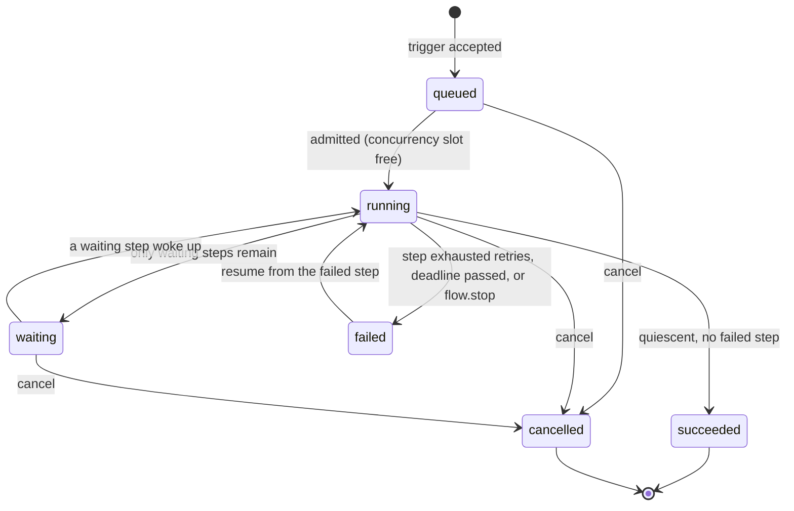
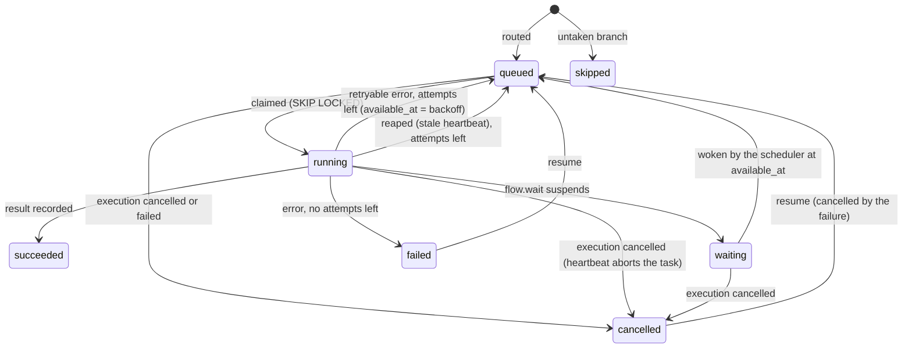

# Low-Level Design

Module-by-module design of Euron WorkflowEngine. Read the [High-Level Design](HLD.md) first
for the big picture; the tables are in the [Data Model](data-model.md).

- [Repository layout](#repository-layout)
- [API layering](#api-layering)
- [Workflow definitions](#workflow-definitions)
- [Node catalog](#node-catalog)
- [Expressions and templates](#expressions-and-templates)
- [Graph validation](#graph-validation)
- [Routing: branches, merges and loops](#routing-branches-merges-and-loops)
- [Execution and step state machines](#execution-and-step-state-machines)
- [The queue: claims, heartbeats and guarded writes](#the-queue-claims-heartbeats-and-guarded-writes)
- [Admission and concurrency limits](#admission-and-concurrency-limits)
- [Retries, backoff and timeouts](#retries-backoff-and-timeouts)
- [Cancellation, resume and retry](#cancellation-resume-and-retry)
- [The scheduler](#the-scheduler)
- [Cron semantics](#cron-semantics)
- [Webhook ingress](#webhook-ingress)
- [The event bus](#the-event-bus)
- [The credentials vault](#the-credentials-vault)
- [Outbound network guard](#outbound-network-guard)
- [Test runs of a single node](#test-runs-of-a-single-node)
- [Versions, import and export](#versions-import-and-export)
- [Dashboard and caching](#dashboard-and-caching)
- [Constants](#constants)

## Repository layout

```text
apps/api/src/workflow_engine/
|-- main.py            app factory: middleware, routers, lifespan
|-- worker.py          worker process: executor loop + scheduler candidate, graceful shutdown
|-- runtime/           long-running loops: executor, scheduler, leader election, presence, clock
|-- cli.py             typer CLI (wfe): migrate, users, demo seed, demo APIs, openapi, worker
|-- core/              config, logging, errors, request context, security, crypto, rate limits, metrics, ids
|-- db/                engine, session, declarative base, migrations runner
|-- models/            SQLAlchemy models, one module per aggregate
|-- schemas/           Pydantic request and response models
|-- repositories/      the only code that touches the database
|-- services/          business rules and transactions (workflows, engine, steps, sweeps, executions, vault, events, ...)
|-- engine/            pure core: definitions, graph validation, routing, expressions, templates, cron, backoff
|-- nodes/             one module per node type: config model, ports, run()
|-- integrations/      AWS clients (S3, SQS, SES, KMS), guarded HTTP transport, Redis signals
|-- api/               routes and dependencies (principal, workspace roles, rate limits)
|-- templates/         the templates gallery (JSON workflow documents)
`-- demo/              demo seed and the demo APIs used by `make demo`
```

## API layering

| Layer | May import | Must not |
| ----- | ---------- | -------- |
| `api/routes` | schemas, services, `api/deps` | touch a session, a repository or Redis directly |
| `services` | repositories, `engine`, `nodes`, `integrations`, `core` | import FastAPI |
| `repositories` | models, `db` | commit, call a service, or skip the `workspace_id` filter |
| `engine` | `core` only | do any I/O; it is pure and unit tested |
| `nodes` | `engine`, `integrations`, `core` | touch the database; a node receives a `NodeContext` and returns a `NodeResult` |

A service method that writes opens and commits its own transaction; routes never commit.
Errors are the typed errors in `core/errors.py`, turned into the one envelope by the
exception handlers.

## Workflow definitions

A definition is a JSON document validated by `engine/definition.py`:

```jsonc
{
  "schema_version": 1,
  "nodes": [
    {
      "id": "fetch_orders",              // ^[a-z][a-z0-9_]{0,47}$, unique, used in templates
      "type": "http.request",
      "name": "Fetch open orders",        // display name, unique
      "config": { "method": "GET", "url": "{{ env.SHOP_API }}/orders" },
      "position": { "x": 320, "y": 120 },
      "retry": { "max_attempts": 4, "initial_delay_ms": 1000, "max_delay_ms": 60000, "multiplier": 2, "jitter": true },
      "timeout_s": 30,
      "on_error": "fail",                 // or "continue"
      "disabled": false,
      "notes": ""
    }
  ],
  "edges": [
    { "id": "e1", "source": "trigger", "source_port": "main", "target": "fetch_orders", "target_port": "main" }
  ]
}
```

Limits: 200 nodes, 500 edges, 256 KB per definition. `retry` and `timeout_s` default per
node type. A disabled node passes its input through unchanged on its first output port.

## Node catalog

Every node type is one module in `nodes/` with a Pydantic config model. The model is the
validation and, exported as JSON Schema with UI hints (`x-widget`, `x-credential-types`,
`x-template`), the form the editor renders. `GET /api/v1/node-types` serves the catalog.

| Type | Ports out | Config (main fields) | Output |
| ---- | --------- | -------------------- | ------ |
| `trigger.manual` | main | `sample_payload` | the run payload |
| `trigger.webhook` | main | `path`, `method`, `auth` (`none`, `hmac_sha256`, `bearer`), `credential_id`, `signature_header`, `timestamp_header`, `tolerance_s`, `idempotency_header`, `response` (`accepted`, `when_finished`) | `{method, path, headers, query, body}` |
| `trigger.cron` | main | `expression`, `timezone`, `overlap` (`allow`, `skip`) | `{scheduled_for, fired_at, timezone}` |
| `trigger.interval` | main | `every`, `unit`, `overlap` | `{scheduled_for, fired_at}` |
| `trigger.event` | main | `event` (exact name or `prefix.*`), `filter` (JMESPath) | `{event, payload, event_id, source}` |
| `http.request` | main | `method`, `url`, `query`, `headers`, `body_type`, `body`, `credential_id`, `timeout_s`, `response_format`, `fail_on_http_error`, `retry_on_status` | `{status, headers, body, url, elapsed_ms}` |
| `core.transform` | main | `mode` (`jmespath`, `template`), `expression`, `template` | the result |
| `core.set` | main | `assignments: [{name, value}]` | the input (variables updated) |
| `flow.if` | true, false | `combinator` (`all`, `any`), `conditions: [{left, operator, right}]` | the input |
| `flow.switch` | one per case, `default` | `value`, `cases: [{port, operator, value}]` | the input |
| `flow.merge` | main | `mode` (`combine`, `append`, `merge_objects`) | combined inputs |
| `flow.loop` | batch, done | `items`, `batch_size`, `max_items` | batch: `{batch, index, total_batches}`; done: `{results, batches, items}` |
| `flow.wait` | main | `mode` (`delay`, `until`), `amount`, `unit`, `until` | the input |
| `flow.stop` | (none) | `code`, `message` | fails the execution on purpose |
| `email.send` | main | `to`, `cc`, `subject`, `text`, `html`, `reply_to` | `{message_id, to}` |
| `aws.s3_put` | main | `bucket`, `key`, `content`, `content_type` | `{bucket, key, etag, size}` |
| `aws.s3_get` | main | `bucket`, `key`, `parse` | `{bucket, key, content_type, size, body}` |
| `aws.sqs_publish` | main | `queue`, `message`, `delay_s`, `group_id`, `attributes` | `{message_id, queue}` |
| `db.postgres_query` | main | `credential_id`, `sql`, `parameters`, `mode` (`read_only`, `read_write`), `max_rows` | `{rows, row_count, columns}` |
| `slack.message` | main | `credential_id`, `text`, `blocks`, `username`, `icon_emoji` | `{status}` |
| `event.emit` | main | `event`, `payload` | `{event_id, matched}` |

A node implementation is `async def run(ctx: NodeContext, config: Config) -> NodeResult`.
`NodeContext` carries the rendered input, the execution context for templates, a logger
that writes step logs, the credential resolver, the AWS clients and the guarded HTTP client.
`NodeResult` carries `output`, the `ports` it emitted on, optional `vars` updates and an
optional `suspend_until` (the wait node). A `NodeError(code, message, retryable)` is how a
node fails; any other exception is treated as retryable.

## Expressions and templates

Two forms, both evaluated against the same read-only context:

```jsonc
{
  "trigger":   { ... },                  // the trigger payload
  "input":     { ... },                  // this step's input
  "steps":     { "fetch_orders": { ... } },  // latest output of each finished node
  "vars":      { ... },                  // execution variables (core.set)
  "env":       { ... },                  // workspace variables (non-secret)
  "execution": { "id", "workflow_id", "started_at", "mode" },
  "now":       "2026-10-23T08:00:00Z"   // the step's start time
}
```

- **JMESPath** (`core.transform` in `jmespath` mode, `flow.loop.items`, event filters):
  standard JMESPath plus a curated function set: `upper`, `lower`, `trim`, `replace`,
  `split`, `format_number`, `round`, `default`, `to_json`, `from_json`, `url_encode`,
  `now`, `format_date`, `date_add`, `unique`.
- **Templates** (every string field marked `x-template`): text with `{{ <JMESPath> }}`
  placeholders. A field that is exactly one placeholder returns the raw value, so
  `"{{ input.items }}"` yields a list, not its string form. Otherwise values are
  interpolated (`null` becomes empty, objects become JSON). `\{{` escapes a literal brace.

Nothing in either form can call Python, import modules, read files or open sockets: the
JMESPath interpreter only walks JSON values and the function set is fixed. Evaluation runs
in a worker thread so a large projection cannot stall heartbeats, and input size is
capped by `MAX_PAYLOAD_KB`.

Only the step outputs a node actually references are loaded: templates are scanned for
`steps.<id>` before the run, so a long execution does not load every earlier output.

## Graph validation

`engine/validation.py` returns a list of issues, each with `severity` (`error`, `warning`),
`node_id`, `field` (a JSON path into the node config) and `message`. Saving a draft
accepts errors (work in progress); publishing refuses them.

| Rule | Severity |
| ---- | -------- |
| At least one trigger node; triggers have no incoming edges | error |
| Unique node ids and names; known node types | error |
| Config matches the node type's schema (with field paths) | error |
| Templates parse and their JMESPath compiles | error |
| Edges reference existing nodes and valid ports | error |
| No cycles, except the back edge into a loop's `loop` input | error |
| A loop body (everything reachable from `batch` without passing the loop) is only entered through `batch` and only leaves through the back edge | error |
| Cron expressions parse; time zones exist; intervals are at least 10 s | error |
| Webhook paths unique in the workspace (checked at publish and activation) | error |
| Referenced credentials exist and have an accepted type | error |
| A node unreachable from every trigger | warning |
| `flow.merge` with fewer than two inputs | warning |

## Routing: branches, merges and loops

`engine/routing.py` is a pure function from "this step finished and emitted on these ports"
plus the execution's routing state to a plan: steps to create, nodes to skip, state
changes. The worker applies the plan in the completion transaction.

**Tokens.** Every edge carries one token per activation of its source: *delivered* (the
port emitted, with the step's output) or *skipped* (it did not).

**Activation rules.**

1. A node with one input runs once per delivered token. A skipped token marks it
   `skipped` and sends skipped tokens down all its outputs, so an untaken branch is
   skipped to its end.
2. A non-merge node with several inputs (an OR join) runs once per delivered token. It is
   marked skipped only when every input reported skipped.
3. `flow.merge` (an AND join) waits until **every** input has reported, delivered or
   skipped, in the same scope, then runs once with the delivered inputs. If all were
   skipped it is skipped. This is dead-path elimination
   ([ADR-0005](adr/0005-dead-path-elimination.md)): a merge after an `if` waits for the
   branch that ran and does not wait for the one that did not.

**Loops and scopes.** `flow.loop` emits one batch at a time on `batch` in a child scope
(`/loop_id:3` for the fourth batch). The body runs, and the token that comes back on the
loop's `loop` input (delivered or skipped) completes the iteration: the loop appends the
delivered result, then emits the next batch or, after the last, `done` in the parent scope
with every result. Iterations are sequential, so `steps.<id>` inside the body always means
the current iteration. Merges inside a body match tokens by scope.

**Quiescence.** When an execution has no queued, running or waiting step left, pending
merges are flushed (missing inputs count as skipped) and pending loop iterations are
completed. If that creates no new step the execution is finished: `succeeded`, or
`failed` when a step failed with `on_error: fail`. Its output is the output of the most
recently finished leaf step.

## Execution and step state machines





## The queue: claims, heartbeats and guarded writes

**Claim** (worker, every loop with free slots):

```sql
UPDATE execution_steps
SET status = 'running', locked_by = :worker, locked_at = now(), heartbeat_at = now(),
    started_at = now()
WHERE id IN (
  SELECT id FROM execution_steps
  WHERE status = 'queued' AND available_at <= now()
  ORDER BY available_at, id
  FOR UPDATE SKIP LOCKED
  LIMIT :free_slots
)
RETURNING *;
```

A partial index on `(available_at, id) WHERE status = 'queued'` keeps this an index scan no
matter how much history the table holds.

**Heartbeat** (every `STEP_HEARTBEAT_S`, one statement for all of a worker's steps):

```sql
UPDATE execution_steps SET heartbeat_at = now()
WHERE id = ANY(:ids) AND locked_by = :worker AND status = 'running'
RETURNING id;
```

A step missing from the result lost its claim (cancelled, reaped or failed by a deadline);
the worker cancels its task. A heartbeat that raises (a database blip) only logs.

**Completion** (one transaction):

1. `SELECT ... FROM executions WHERE id = :id FOR UPDATE`: completions of one execution are
   serialized, so parallel branches cannot both decide they were the last.
2. Guarded update of the step (`WHERE id AND locked_by = :worker AND status = 'running'`).
   Zero rows: the claim was lost; roll back and drop the result.
3. Apply the routing plan: insert new steps, mark skipped ones, update routing state and
   variables.
4. Recompute the execution status; when finished, write output and error, insert the dead
   letter, publish `execution.succeeded` or `execution.failed` on the event bus and admit
   the next queued execution of the workflow.
5. Commit, then `PUBLISH wfe:wake` so idle workers claim the new steps at once.

Lock order is always execution, then steps; admission locks the workflow row and only uses
`SKIP LOCKED` on executions, so the two paths cannot deadlock.

## Admission and concurrency limits

`workflows.concurrency_limit` caps how many executions of a workflow are `running` at
once (null means unlimited). New executions start `queued`. `admit(workflow_id)`:

```sql
SELECT id FROM workflows WHERE id = :wf FOR UPDATE;                 -- serialize admissions
SELECT count(*) FROM executions WHERE workflow_id = :wf AND status = 'running';
SELECT id FROM executions WHERE workflow_id = :wf AND status = 'queued'
ORDER BY created_at LIMIT :free FOR UPDATE SKIP LOCKED;            -- oldest first
```

Each admitted execution becomes `running`, gets its `deadline_at`, records its trigger as
a succeeded step and routes from it. Admission runs when an execution is created, when one
finishes, and every scheduler tick as a safety net. Waiting executions do not hold a slot.

## Retries, backoff and timeouts

Retry policy per node (defaults per type: `http.request` 3 attempts, AWS nodes 3, others 1):

```text
delay(attempt) = min(max_delay_ms, initial_delay_ms * multiplier ** (attempt - 1))
with jitter:     delay / 2 + random(0, delay / 2)          # "equal jitter": a floor and a spread
```

Retryable: network errors, timeouts, HTTP 429 and 5xx (configurable list), AWS throttling,
unknown exceptions. Not retryable: validation and template errors, HTTP 4xx other than the
list, `flow.stop`, read-only violations. Each scheduled retry writes a step log line with
the delay and the error.

`timeout_s` per node (default per type, at most 900 s) wraps the run in
`asyncio.timeout`. `workflows.timeout_s` (default 3600 s) sets `deadline_at`; the scheduler
fails executions past it with `execution_timeout`.

## Cancellation, resume and retry

- **Cancel** (`POST .../cancel`): in one transaction the execution becomes `cancelled` and
  every queued, waiting or running step `cancelled`. `PUBLISH wfe:cancel` lets workers
  abort running tasks immediately; the next heartbeat would have caught them anyway.
- **Resume** (`POST .../resume`, or retry on a dead letter): only for `failed`. The failed
  steps and the steps cancelled because of the failure return to `queued` with a fresh
  retry budget (`max_attempts = attempt + policy.max_attempts`), the execution returns to
  `running`, `resume_count` increments and open dead letters become `retried`. Succeeded
  steps are not repeated.
- **Retry from start** (`POST .../retry`): a new execution of the same version with the
  same trigger payload and `retry_of_id` set. The original is untouched.

## The scheduler

Every worker runs the scheduler loop; only the holder of `wfe:scheduler:leader` acts.

| Step | Detail |
| ---- | ------ |
| Election | `SET key worker_id NX PX 15000`; the holder renews every tick with a compare-and-`PEXPIRE` script and steps down if the renewal fails; shutdown releases with compare-and-`DEL` |
| Fire schedules | `SELECT ... FROM workflow_triggers WHERE next_fire_at <= now() FOR UPDATE SKIP LOCKED LIMIT 100`; per trigger: start an execution with idempotency key `schedule:{trigger_id}:{due}`, then `next_fire_at` = first tick after now (missed ticks coalesce into one run). `overlap: skip` skips the tick while an execution of the workflow is queued or running |
| Wake | `waiting` steps with `available_at <= now()` become `queued` with `state.resumed = true`; their execution becomes `running` |
| Reap | `running` steps with `heartbeat_at < now() - STEP_STALE_S` are requeued (next attempt) or failed with `worker_lost` through the completion path |
| Deadlines | executions past `deadline_at` fail with `execution_timeout` |
| Admit | workflows with queued executions get an admission pass |
| Prune | hourly, executions finished more than the workspace's `retention_days` ago, in batches of 500 |
| Stats | queue depth by state written to Redis every 5 s for `/metrics` and the dashboard |

Correctness never depends on the lock: firing is a compare-and-set inside a row lock, and
every other duty is a guarded update. The lock only stops two workers from doing the same
sweep twice.

## Cron semantics

`engine/cron.py` implements standard five-field cron (`minute hour day-of-month month
day-of-week`) with ranges, steps, lists, names (`JAN`, `MON`), `@hourly`, `@daily`,
`@weekly`, `@monthly`, `@yearly`, and Vixie semantics for day matching (if both day fields
are restricted, either may match). Times are computed in the trigger's IANA time zone:

- **Spring forward**: a wall-clock time that does not exist (02:30 on the transition day)
  fires at the first valid instant after the gap, once.
- **Fall back**: a wall-clock time that happens twice fires once, at the first occurrence.
- `next_after(instant)` walks months, days, hours and minutes, never minute by minute, so
  a yearly schedule costs the same as a minutely one.

## Webhook ingress

`ANY /hooks/{workspace_slug}/{path}`:

1. Look up the trigger by `(workspace, path)` (unique among active workflows). Unknown or
   inactive: 404. Wrong method: 405.
2. Rate limit per trigger (`RATE_LIMIT_WEBHOOK` per minute); body capped at
   `WEBHOOK_MAX_BODY_KB`.
3. Authenticate. `hmac_sha256`: `hex(HMAC_SHA256(secret, raw_body))`, or
   `HMAC(secret, timestamp + "." + raw_body)` when a timestamp header is configured, in
   which case the timestamp must be within `tolerance_s`. Compared in constant time, prefix
   (`sha256=`) optional. `bearer`: constant-time comparison of a token header. The secret
   is a `webhook_secret` credential.
4. Parse the body (JSON, form or text) and start the execution with the idempotency key from
   the configured header. A repeated key returns the existing execution with
   `"duplicate": true` and runs nothing.
5. `response: accepted` answers 202 at once; `when_finished` waits up to
   `response_timeout_s` (at most 25 s) and answers 200 with the output, or 202 if it is
   still running.

## The event bus

`POST /api/v1/workspaces/{ws}/events` and the `event.emit` node insert an `events` row and,
in the same transaction, start one execution per active workflow whose event trigger
matches the name (exact, or `prefix.*`) and whose `filter` JMESPath is truthy against the
payload. The engine publishes `execution.succeeded` and `execution.failed` system events
when executions finish.

Loops are prevented two ways: every event carries a `depth` (an execution triggered by an
event at depth d emits at d + 1, refused beyond `EVENT_MAX_DEPTH`, 5), and executions
started by an `execution.*` event never publish `execution.*` events themselves, so a
failing failure handler cannot trigger itself.

## The credentials vault

```text
create:  dek, wrapped = KMS.GenerateDataKey(KeyId, AES_256, EncryptionContext={workspace, credential})
         nonce = random(12); ciphertext = AES-256-GCM(dek, nonce, json(secret), aad=workspace|credential)
         store wrapped, nonce, ciphertext; zero dek
use:     dek = KMS.Decrypt(wrapped, EncryptionContext=...); plaintext = GCM.open(...)
```

- The encryption context binds a wrapped key to its workspace and credential: copying a row
  to another workspace makes it undecryptable.
- `VAULT_PROVIDER=local` (tests and laptops without the emulator) wraps data keys with
  AES-256-GCM under a key derived by HKDF from `VAULT_LOCAL_KEY`; production refuses it.
- The API returns metadata, the non-secret fields (a username, a host) and the names of the
  secret fields, never their values. Updating a secret replaces it; there is no read.
- Workers decrypt per step and keep plaintext only for the step's duration. Secret values
  are redacted from step inputs, outputs and logs by value before they are stored.

## Outbound network guard

`integrations/http.py` builds every outbound HTTP client (HTTP node, Slack node) on a
custom network backend: the hostname is resolved, every address is checked against the
blocked ranges (private, loopback, link-local, CGNAT, multicast, reserved, unique-local,
the metadata address), and the TCP connection is opened to the checked address while TLS
still verifies the hostname. Redirects go through the same backend. Deployments allow
specific hosts with `OUTBOUND_ALLOWED_HOSTS` or everything with `OUTBOUND_ALLOW_PRIVATE_NETWORKS`
(refused in production).

## Test runs of a single node

`POST /api/v1/workspaces/{ws}/nodes/test` takes a node (type and config) and a context
(`input`, `trigger`, `steps`, `vars`), renders the templates, runs the node in the API
process with its timeout and returns `{status, output, ports, logs, duration_ms, error}`.
Nothing is written to the execution tables. It needs the editor role and is rate limited.
Nodes with side effects really perform them; the editor says so before running one.

## Versions, import and export

- The draft is saved with optimistic concurrency (`draft_revision`); a stale save is a 409.
- Publishing validates, stores an immutable `workflow_versions` row (`number` n + 1, a
  checksum of the canonical JSON) and, when the workflow is active, rebuilds its rows in
  `workflow_triggers` (keeping `next_fire_at` for unchanged schedules).
- Running the draft from the editor stores a `snapshot` version (deduplicated by checksum),
  so every execution references an immutable definition.
- Export writes `{format: "euron-workflow", format_version: 1, name, description, tags,
  settings, definition}`; credential ids become `{credential: {name, type}}` references,
  resolved by name and type on import.

## Dashboard and caching

`GET /api/v1/workspaces/{ws}/dashboard?window=24h|7d|14d` returns the success rate,
counts by status, a volume series by hour or day in the workspace time zone, the five
slowest workflows by p95 duration, recent failures, queue depth, live workers (from their
Redis presence keys) and the next schedules. The response is cached in Redis for 15 s per
workspace and window.

| Cache | Store | TTL | Invalidated by |
| ----- | ----- | --- | -------------- |
| Published definitions | process memory (LRU 512) | forever | immutable |
| Dashboard | Redis | 15 s | expiry |
| Webhook trigger lookup | process memory | 5 s | expiry (activation changes appear within 5 s) |
| Decrypted credentials | step memory only | one step | n/a |
| Session revocations | Redis | token lifetime | n/a |

## Constants

| Name | Default | Where |
| ---- | ------- | ----- |
| `WORKER_CONCURRENCY` | 8 steps per worker | config |
| `WORKER_POLL_INTERVAL_MS` | 1000 | config |
| `STEP_HEARTBEAT_S` / `STEP_STALE_S` | 10 / 60 | config |
| `LEADER_TTL_S` | 15 | config |
| `SCHEDULER_TICK_MS` | 1000 | config |
| `MAX_PAYLOAD_KB` | 1024 per step input or output | config |
| `WEBHOOK_MAX_BODY_KB` | 1024 | config |
| `EVENT_MAX_DEPTH` | 5 | config |
| Node timeout | 30 s default, 900 s max | node |
| Execution timeout | 3600 s default | workflow |
| Wait | 30 days max | `flow.wait` |
| Loop | 10 000 items max, batches of 1 to 1000 | `flow.loop` |
| Postgres node | 500 rows default, 10 000 max, 30 s statement timeout | `db.postgres_query` |
