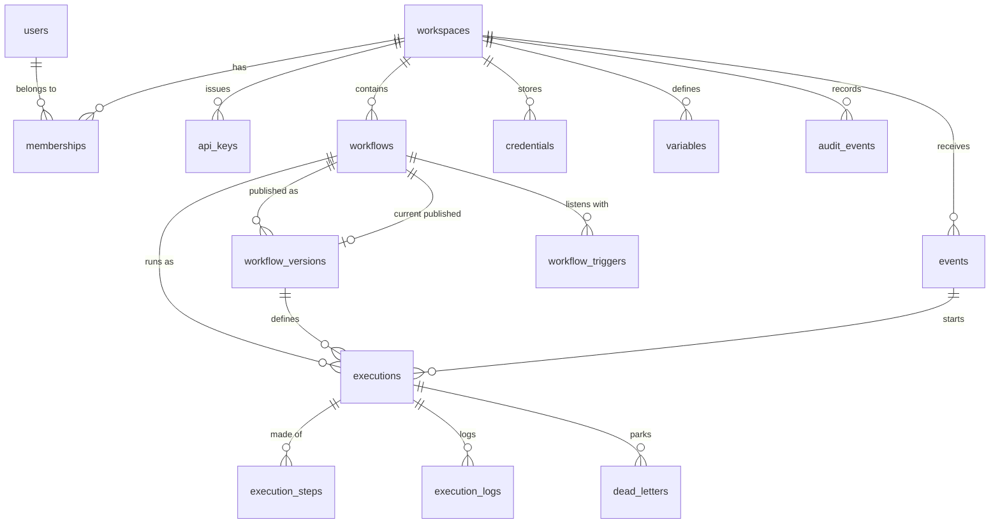

# Data Model

All state lives in one PostgreSQL 16 database, defined by the Alembic migrations in
[`apps/api/src/workflow_engine/migrations`](../../apps/api/src/workflow_engine/migrations).
The SQLAlchemy models are in [`models/`](../../apps/api/src/workflow_engine/models).
Redis holds only derived or short-lived data (locks, wake-ups, rate limits, caches) and can
be flushed at any time without losing work.

- [Conventions](#conventions)
- [Entity relationships](#entity-relationships)
- [Tables](#tables)
- [Indexes and why they exist](#indexes-and-why-they-exist)
- [Triggers](#triggers)
- [JSON documents](#json-documents)
- [Redis keys](#redis-keys)
- [Retention](#retention)
- [Migration policy](#migration-policy)

## Conventions

- Primary keys are UUID version 7 (time ordered), generated by the application, so inserts
  land at the right edge of the index.
- Every table that holds workspace data has a `workspace_id`, and every repository query
  filters by it ([ADR-0009](adr/0009-workspaces-as-the-tenant-boundary.md)).
- Value sets (statuses, roles, kinds) are `text` with `CHECK` constraints, cheaper to evolve
  than Postgres enums.
- Timestamps are `timestamptz`, written by the database (`now()`) where possible.
- Constraint and index names follow one naming convention (`ix_`, `uq_`, `ck_`, `fk_`, `pk_`).

## Entity relationships

## Tables

### Identity and access (shared with the other Euron services)

| Table | Columns | Notes |
| ----- | ------- | ----- |
| `users` | `id`, `email` (citext, unique), `name`, `password_hash` (Argon2id), `is_admin`, `session_version`, `failed_logins`, `locked_until`, `last_login_at`, `created_at`, `updated_at` | Bumping `session_version` signs a user out everywhere |
| `workspaces` | `id`, `slug` (unique), `name`, `description`, `settings` (jsonb), `created_by`, `created_at`, `updated_at` | `settings`: `timezone`, `retention_days`, `default_timeout_s` |
| `memberships` | `workspace_id`, `user_id` (composite PK), `role` (`owner`, `editor`, `viewer`), `created_at` | |
| `api_keys` | `id`, `workspace_id`, `created_by`, `name`, `prefix` (unique), `secret_hash`, `role` (`editor`, `viewer`), `last_used_at`, `expires_at`, `revoked_at`, `created_at` | Key format `wfk_<prefix>_<secret>`; only an HMAC of the secret is stored |
| `audit_events` | `id`, `workspace_id`, `actor_user_id`, `actor_api_key_id`, `action`, `target_type`, `target_id`, `details` (jsonb), `created_at` | Append-only (see [Triggers](#triggers)) |

### Workflows

| Table | Columns | Notes |
| ----- | ------- | ----- |
| `workflows` | `id`, `workspace_id`, `name`, `description`, `tags` (text[]), `draft` (jsonb definition), `draft_revision`, `draft_updated_at`, `draft_updated_by`, `published_version_id`, `active`, `activated_at`, `concurrency_limit` (null = unlimited), `timeout_s`, `template_slug`, `created_by`, `created_at`, `updated_at` | Name unique per workspace |
| `workflow_versions` | `id`, `workspace_id`, `workflow_id`, `kind` (`published`, `snapshot`), `number` (published only), `definition` (jsonb), `checksum` (sha256 of canonical JSON), `note`, `created_by`, `created_at` | Immutable; `snapshot` rows back draft test runs |
| `workflow_triggers` | `id`, `workspace_id`, `workflow_id`, `version_id`, `node_id`, `kind` (`webhook`, `cron`, `interval`, `event`), `webhook_path`, `webhook_method`, `event_name`, `cron_expression`, `timezone`, `interval_s`, `config` (jsonb), `next_fire_at`, `last_fired_at`, `created_at` | Rows exist only for active workflows' published versions |
| `variables` | `workspace_id`, `key` (composite PK), `value`, `description`, `updated_by`, `updated_at` | Non-secret settings readable in templates as `env.KEY` |

### Execution

| Table | Columns | Notes |
| ----- | ------- | ----- |
| `executions` | `id`, `workspace_id`, `workflow_id`, `version_id`, `status`, `mode` (`production`, `manual`, `test`), `trigger_kind`, `trigger_node_id`, `trigger_payload` (jsonb), `idempotency_key`, `event_id`, `event_depth`, `retry_of_id`, `resume_count`, `state` (jsonb routing state and variables), `output` (jsonb), `error` (jsonb), `created_by_user_id`, `created_by_api_key_id`, `created_at`, `started_at`, `finished_at`, `duration_ms`, `deadline_at`, `updated_at` | `status`: `queued`, `running`, `waiting`, `succeeded`, `failed`, `cancelled` |
| `execution_steps` | `id`, `execution_id`, `workspace_id`, `node_id`, `node_type`, `node_name`, `run_index`, `scope`, `status`, `attempt`, `max_attempts`, `input`, `output`, `ports` (text[]), `error`, `state` (jsonb), `available_at`, `locked_by`, `locked_at`, `heartbeat_at`, `timeout_s`, `started_at`, `finished_at`, `duration_ms`, `created_at`, `updated_at` | The queue. `status`: `queued`, `running`, `waiting`, `succeeded`, `failed`, `skipped`, `cancelled` |
| `execution_logs` | `id`, `execution_id`, `step_id`, `workspace_id`, `level`, `message`, `data` (jsonb), `created_at` | Retry decisions, HTTP status lines, rows returned |
| `dead_letters` | `id`, `workspace_id`, `workflow_id`, `execution_id`, `step_id`, `node_id`, `error` (jsonb), `input` (jsonb), `status` (`open`, `retried`, `discarded`), `resolved_at`, `resolved_by`, `created_at` | One per terminal step failure |

### Credentials and events

| Table | Columns | Notes |
| ----- | ------- | ----- |
| `credentials` | `id`, `workspace_id`, `name`, `type`, `description`, `public_fields` (jsonb), `secret_fields` (text[]), `ciphertext`, `nonce`, `wrapped_key`, `key_provider` (`kms`, `local`), `key_ref`, `version`, `created_by`, `created_at`, `updated_at`, `last_used_at` | Name unique per workspace; secrets never leave the service |
| `events` | `id`, `workspace_id`, `name`, `payload` (jsonb), `source` (`api`, `workflow`, `system`), `source_execution_id`, `depth`, `matched`, `created_at` | The bus log; matched executions reference it through `executions.event_id` |

## Indexes and why they exist

| Index | Serves |
| ----- | ------ |
| `execution_steps (available_at, id) WHERE status = 'queued'` | The claim query; stays small however large history grows |
| `execution_steps (heartbeat_at) WHERE status = 'running'` | The reaper |
| `execution_steps (available_at) WHERE status = 'waiting'` | Waking delayed steps |
| `execution_steps (execution_id, created_at)` | Timeline and the active-step count at completion |
| `executions (workspace_id, created_at DESC, id DESC)` | Execution list with keyset pagination, dashboard windows |
| `executions (workflow_id, created_at DESC)` | Per-workflow history and stats |
| `executions (workflow_id, created_at) WHERE status = 'queued'` | Admission, oldest first |
| `executions (workflow_id) WHERE status = 'running'` | Concurrency counting |
| `executions (deadline_at) WHERE status IN ('running', 'waiting')` | Deadline enforcement |
| `executions (workflow_id, idempotency_key)` unique | Webhook and run idempotency, one execution per schedule tick |
| `executions (finished_at) WHERE finished_at IS NOT NULL` | Retention pruning |
| `workflow_triggers (next_fire_at) WHERE kind IN ('cron', 'interval')` | Due schedules |
| `workflow_triggers (workspace_id, webhook_path)` unique where `kind = 'webhook'` | Webhook routing and path uniqueness |
| `workflow_triggers (workspace_id, event_name)` where `kind = 'event'` | Event matching |
| `workflow_versions (workflow_id, number)` unique where `number IS NOT NULL` | Version history |
| `workflow_versions (workflow_id, checksum)` | Snapshot deduplication |
| `workflows (workspace_id, name)` unique, GIN on `tags` | List, search and tag filters |
| `execution_logs (execution_id, id)` | Logs of one execution in order |
| `dead_letters (workspace_id, status, created_at DESC)` | Open dead letters first |
| `events (workspace_id, created_at DESC)`, `events (workspace_id, name, created_at DESC)` | Event log and filters |
| `audit_events (workspace_id, created_at DESC)` | Audit page |
| `credentials (workspace_id, name)` unique | Lookup and import resolution |

## Triggers

| Trigger | Table | Effect |
| ------- | ----- | ------ |
| `audit_events_append_only` | `audit_events` | Refuses `UPDATE`, and refuses `DELETE` unless it is a cascade from deleting the workspace (`pg_trigger_depth() > 1`) |
| `workflow_versions_immutable` | `workflow_versions` | Refuses `UPDATE`: a version that ran must stay exactly what ran |

## JSON documents

| Column | Shape |
| ------ | ----- |
| `workflows.draft`, `workflow_versions.definition` | The workflow definition (`schema_version`, `nodes`, `edges`), see [LLD](LLD.md#workflow-definitions) |
| `executions.state` | `{vars: {}, joins: {"<node>@<scope>": {"<edge>": {"delivered", "step_id"}}}, arrivals: {...}, loops: {"<node>@<scope>": {items, batch_size, index, results}}}` |
| `executions.error`, `execution_steps.error` | `{code, message, retryable?, node_id?, step_id?, details?}` |
| `execution_steps.state` | Node-specific: `{resumed: true}` after a wait, `{disabled: true}` for a passed-through node |
| `workflow_triggers.config` | The trigger node's validated configuration |
| `credentials.public_fields` | Non-secret fields of the credential type (for example `username`, `host`) |

## Redis keys

| Key | Type | TTL | Purpose |
| --- | ---- | --- | ------- |
| `wfe:scheduler:leader` | string (worker id) | 15 s, renewed | Scheduler leadership |
| `wfe:wake` | pub/sub channel | n/a | New steps are ready |
| `wfe:cancel` | pub/sub channel | n/a | Abort running steps of an execution |
| `wfe:workers:<worker id>` | string (JSON) | 30 s, refreshed | Live workers for the dashboard |
| `wfe:stats:queue` | string (JSON) | 30 s | Queue depth by state, written by the leader |
| `wfe:dash:<workspace>:<window>:<timezone>` | string (JSON) | 15 s | Dashboard cache |
| `rl:<bucket>:<key>:<window>` | counter | window | Rate limits |
| `session:revoked:<jti>` | string | token lifetime | Signed-out sessions |
| `apikey:touched:<id>` | string | 60 s | Throttles `last_used_at` writes of API keys |
| `cred:touched:<id>` | string | 60 s | Throttles `last_used_at` writes of credentials |

## Retention

The scheduler leader deletes executions that finished more than the workspace's
`retention_days` ago (30 by default), in batches of 500; their steps, logs and dead letters
go with them by cascade. Events older than the same window are pruned too. The audit log is
kept.

## Migration policy

Forward-only Alembic revisions, run under a Postgres advisory lock so concurrent starts are
safe: by the `migrate` one-shot before anything else starts (compose), when an API task boots
with `MIGRATE_ON_BOOT=true` (AWS), or on demand with `wfe migrate` (`make aws-migrate`). Never
edit an applied revision; add a new one.
