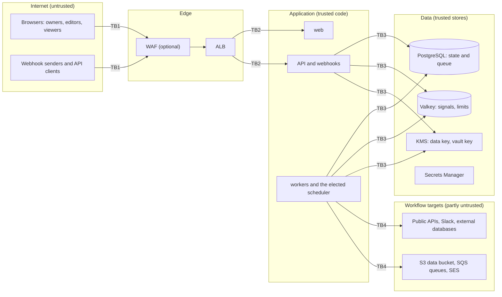

# Threat model

A STRIDE analysis of Euron WorkflowEngine as deployed by `infra/terraform` (an
`aws-prod`-shaped environment) with the defaults in the code. Each row names the threat,
the control that exists today, and what remains. The controls are described in
[security.md](security.md); the decisions behind them in the [ADRs](adr/README.md).

Residual risks are stated plainly. "Accepted" marks a design choice; "open" marks a known
gap.

## Scope and trust boundaries

| Boundary | Crossing |
| --- | --- |
| TB1 | Public internet to the edge: every request, including signed webhooks, is untrusted |
| TB2 | Edge to tasks: TLS terminates at the ALB; tasks run in private subnets |
| TB3 | Tasks to their stores: task roles, security groups, TLS to RDS and Valkey |
| TB4 | Workers to the systems workflows call: chosen by editors, guarded by the outbound policy and allowlists |
| Logical | Workspace to workspace; editor-authored configuration to the worker that executes it |

## Assets, ranked

| Rank | Asset | Why it ranks here |
| --- | --- | --- |
| 1 | Stored credentials (API tokens, database passwords, webhook secrets, Slack URLs) | Direct access to third-party systems; sealed with the vault key |
| 2 | Key material and secrets: the vault key, `SESSION_SECRET`, `API_KEY_PEPPER`, the RDS password, the Valkey token | Each forges sessions or API keys, or unlocks rank 1 |
| 3 | The ability to run workflows (editor sessions, editor API keys, webhook paths) | Acts with every credential of a workspace against every target the deployment allows |
| 4 | The internal network position of the workers | Reaches the database, Valkey and cloud metadata if the outbound guard fails |
| 5 | Execution data: trigger payloads, step input and output, logs | Business data from every system workflows touch (orders, customers, invoices) |
| 6 | Workflow definitions and versions | Integrity: a modified workflow sends data or money to the wrong place |
| 7 | The audit log | Accountability for changes to workflows, credentials and access |
| 8 | Terraform state | Contains the generated application secrets |
| 9 | Availability of the queue and the scheduler | Missed schedules and delayed business processes |

## Spoofing

| Threat | Mitigation | Residual |
| --- | --- | --- |
| Password guessing | Argon2id (64 MiB); 10 attempts a minute per address, shared across replicas in Valkey; equal timing for unknown accounts | No per-account lockout and no second factor (open). Put the app behind SSO or a VPN for high-value deployments. |
| Stolen session cookie | `httpOnly`, `Secure`, `SameSite=Lax`; 7-day lifetime; sign-out denylists the token; password change and "sign out everywhere" invalidate all tokens | A stolen cookie works until it expires or the user signs out everywhere (accepted). |
| Cross-site request with the victim's cookie | Origin check on every unsafe method with a cookie session; explicit CORS origins | None identified. |
| Forged session JWT | HS256 with a generated 64-character secret; production refuses default, short or shared secrets; issuer and audience checked | Anyone holding `SESSION_SECRET` can mint sessions (see rank 2). |
| Stolen or leaked API key | Stored as a peppered HMAC; shown once; scoped to one workspace and a role (viewer or editor, never owner); optional expiry; revocation; last use visible | A leaked editor key runs workflows until revoked (accepted); prefer expiring keys. |
| Forged webhook | HMAC-SHA256 over the raw body, constant-time compare, optional timestamp binding with a tolerance window; bearer mode for senders that cannot sign | A trigger configured with `auth: none` accepts anyone who knows the URL (accepted, flagged in the editor). Bearer tokens without a timestamp can be replayed by whoever sees one; idempotency keys only help when the sender sets them. |

## Tampering

| Threat | Mitigation | Residual |
| --- | --- | --- |
| Editing a workflow that is running | Executions run the version they started with; published versions are immutable (database trigger) | None identified. |
| Two editors overwriting each other | Draft saves carry the revision they started from; a stale save is refused | None identified. |
| Altering execution results by a stale or rogue worker | Guarded writes: only the worker holding the claim, while the step is running, can complete it | A compromised worker task can write anything to the database (accepted: workers are trusted code). |
| Expression or template injection | JMESPath and logic-free templates cannot execute code or reach the network; values are inserted as data, never re-parsed as expressions | None identified. |
| SQL injection through the Postgres node | Parameters are bound by the driver; read-only transactions by default | An editor with `read_write` and a credential that can write can change that database (accepted: it is what the node is for). |
| Tampering with stored credentials | AES-GCM authentication, bound to workspace and credential id; a moved or edited row fails to open | None identified. |
| Rewriting the audit trail | `audit_events` is append-only by trigger | A database superuser can disable the trigger (accepted; RDS master credentials are managed by RDS). |

## Repudiation

| Threat | Mitigation | Residual |
| --- | --- | --- |
| Denying a change to a workflow, a credential, members or keys | Audit row with actor (user or API key), target and details for every mutation | Reads (who looked at which execution) are not audited (accepted). |
| Denying a run | Every execution records trigger kind, payload, version, and for manual runs the user | Webhook senders are identified only by their signature or token (accepted). |

## Information disclosure

| Threat | Mitigation | Residual |
| --- | --- | --- |
| Reading another workspace's data | Workspace resolved and role checked on every route; repository filters by workspace; non-members get 404 | A missed filter in a new repository method would leak; integration tests cover cross-workspace access for the existing ones (open, process). |
| Reading a stored credential through the API | Write-only: the API never returns secret fields | None identified. |
| Exfiltrating a credential through a workflow | Values are redacted from step output, errors, logs and test results | An editor can send a credential to a server they control (it is a credential's purpose to be sent), or make a remote service echo it transformed (for example base64) so redaction does not match. Editors are trusted with the workspace's credentials (accepted, documented). |
| SSRF to metadata, the database or internal services | Outbound guard checks every resolved address and connects to the checked IP; private, loopback, link-local, metadata and reserved ranges refused; redirects re-checked; egress limited to 443 and configured ports | An operator allowlist (`OUTBOUND_ALLOWED_HOSTS`) widens it deliberately (accepted). |
| Reading other buckets or queues with the task role | S3 and SQS allowlists in the node; the task role can reach only the data bucket and the workflow queues | None identified. |
| Database dump or snapshot leak | Credentials sealed with the vault key; RDS, snapshots and logs encrypted with the data key | Execution payloads and outputs are encrypted only at rest, not field-sealed (accepted). |
| Secrets in logs | Structured logs never include credential values; secrets reach tasks from Secrets Manager, not task definitions | Execution data (customer records in payloads) is visible to workspace viewers by design (accepted). |
| Terraform state | Holds generated secrets; the backend example requires a private, versioned, encrypted bucket | Operator responsibility (accepted). |

## Denial of service

| Threat | Mitigation | Residual |
| --- | --- | --- |
| Webhook floods | Per-trigger rate limit, body size cap, optional WAF rate rule | A flood of valid signed requests is limited only by the per-trigger budget (accepted). |
| A workflow that fans out or loops forever | Node and payload limits, loop batch caps, per-node and per-execution timeouts, event chain depth limit, `overlap: skip` for schedules | A workspace can still fill the shared queue with legitimate work and slow other workspaces (accepted: per-workflow concurrency limits help; there is no per-workspace quota yet, open). |
| Slow downstream APIs tying up workers | Per-request and per-step timeouts; worker concurrency bounded | None identified. |
| Huge responses or query results | `max_response_kb`, row caps, `MAX_PAYLOAD_KB` on stored output | None identified. |
| Losing the scheduler leader | Lock TTL; another worker takes over within 15 s; ticks coalesce | Up to one TTL of schedule delay (accepted). |
| Valkey outage | Workers fall back to polling; leadership pauses; rate-limited routes answer 503 | Schedules pause until Valkey returns (accepted). |

## Elevation of privilege

| Threat | Mitigation | Residual |
| --- | --- | --- |
| A viewer changing workflows | Role checks on every mutating route; the UI hides controls but the API enforces | None identified. |
| An editor gaining owner powers | Members, settings, API keys and the audit log require owner; API keys can never be owners | None identified. |
| Code execution through node configuration | No code node; nodes validate configuration against their schema | None identified. |
| Escaping to the cloud account from a task | Narrow task roles; vault key usable only with the credential encryption context; data key only via S3, SQS and Secrets Manager; no ECS exec; read-only root filesystem | None identified. |
